# 🛍️ Vendora — Distributed E-Commerce Microservices Platform

<div align="center">

[](https://nodejs.org/)
[](https://expressjs.com/)
[](https://www.mongodb.com/)
[](https://www.rabbitmq.com/)
[](https://redis.io/)
[](https://ai.google.dev/)
[](https://socket.io/)
[](https://razorpay.com/)
[](https://jestjs.io/)
[](LICENSE)

<p align="center">
  <b>An enterprise-grade, event-driven, multi-vendor microservices e-commerce platform built with Node.js, Express, RabbitMQ, MongoDB, Redis, and Google Gemini AI.</b>
</p>

[Architecture](#-system-architecture) •
[Event Topology](#-rabbitmq-event-topology) •
[Project Structure](#-project-structure) •
[Services Overview](#-services-at-a-glance) •
[Service Documentation](#1%EF%B8%8F-auth-service-auth--port-3000) •
[Database Schemas](#%EF%B8%8F-database-schemas) •
[Quick Start](#-getting-started) •
[Testing](#-testing-suite) •
[Gotchas & Notes](#%EF%B8%8F-architecture-gotchas--implementation-notes)

</div>

---

## 📌 Project Overview

**Vendora** is a distributed multi-vendor e-commerce platform architected as eight autonomous microservices. Each service maintains database isolation (Database-per-Service pattern), publishes domain events via **RabbitMQ** for asynchronous tasks (CQRS read-models, transactional emails), and provides synchronous REST endpoints for high-consistency transactions. An agentic **AI Shopping Assistant** powered by Google Gemini 2.0 Flash and LangGraph delivers real-time conversational shopping over WebSockets.

### 🏗️ Services at a Glance

| # | Service | Port | Database | Primary Responsibility |
| :- | :--- | :---: | :--- | :--- |
| 1 | **[Auth](#1%EF%B8%8F-auth-service-auth--port-3000)** | `3000` | `VendoraAuth` + Redis | Identity, JWT issuance, Redis token blacklist, address management |
| 2 | **[Products](#2%EF%B8%8F-products-service-products--port-3001)** | `3001` | `VendoraProducts` | Product catalog, RBAC, ImageKit CDN image uploads, text search |
| 3 | **[Cart](#3%EF%B8%8F-cart-service-cart--port-3002)** | `3002` | `VendoraCart` | Customer shopping cart, auto-provisioning, quantity management *(no MQ)* |
| 4 | **[Order](#4%EF%B8%8F-order-service-order--port-3003)** | `3003` | `VendoraOrder` | Order lifecycle, cart checkout, address updates, cancellation |
| 5 | **[Payment](#5%EF%B8%8F-payment-service-payment--port-3004)** | `3004` | `VendoraPayment` | Razorpay order creation, HMAC signature verification, status publishing |
| 6 | **[AI-Buddy](#6%EF%B8%8F-ai-buddy-service-ai-buddy--port-3005)** | `3005` | Stateless (Agentic) | Gemini 2.0 Flash assistant, LangGraph tool-calling over Socket.IO |
| 7 | **[Notification](#7%EF%B8%8F-notification-service-notification--port-3006)** | `3006` | Stateless (Consumer) | Pure event consumer, Nodemailer + Gmail OAuth2 transactional email |
| 8 | **[Seller-Dashboard](#8%EF%B8%8F-seller-dashboard-service-seller-dashboard--port-3007)** | `3007` | `VendoraSellerDash` | CQRS read-model replica, seller sales metrics, revenue analytics |

---

## 🏛️ System Architecture

```mermaid
flowchart TB
    Client["🌐 Client Applications\n(Web, Mobile, Postman)"]

    subgraph SynchronousCluster["Microservices Tier (REST HTTP & WebSocket)"]
        Auth["Auth Service\n:3000\n(JWT & Redis)"]
        Products["Products Service\n:3001\n(Catalog & ImageKit)"]
        Cart["Cart Service\n:3002\n(Sessionless Cart)"]
        Order["Order Service\n:3003\n(Checkout & Status)"]
        Payment["Payment Service\n:3004\n(Razorpay Gateway)"]
        AIBuddy["AI-Buddy Service\n:3005\n(Gemini 2.0 + Socket.IO)"]
    end

    subgraph EventTier["Asynchronous Event Tier (RabbitMQ Broker)"]
        MQ_AUTH_NOTIF["AUTH_NOTIFICATION.USER_CREATED"]
        MQ_AUTH_SD["AUTH_SELLER_DASHBOARD.USER_CREATED"]
        MQ_PROD_NOTIF["PRODUCT_NOTIFICATION.PRODUCT_CREATED"]
        MQ_PROD_SD["PRODUCT_SELLER_DASHBOARD.PRODUCT_CREATED"]
        MQ_ORDER_SD["ORDER_SELLER_DASHBOARD.ORDER_CREATED"]
        MQ_PAY_NOTIF_INIT["PAYMENT_NOTIFICATION.PAYMENT_INITIATED"]
        MQ_PAY_NOTIF_COMP["PAYMENT_NOTIFICATION.PAYMENT_COMPLETED"]
        MQ_PAY_NOTIF_FAIL["PAYMENT_NOTIFICATION.PAYMENT_FAILED"]
        MQ_PAY_SD_CREATE["PAYMENT_SELLER_DASHBOARD.PAYMENT_CREATED"]
        MQ_PAY_SD_VERIFY["PAYMENT_SELLER_DASHBOARD.PAYMENT_VERIFY"]
    end

    subgraph ConsumerCluster["Asynchronous Consumer Services"]
        Notification["Notification Service\n:3006\n(Gmail OAuth2 Mailer)"]
        SellerDash["Seller-Dashboard Service\n:3007\n(CQRS Read-Model & Analytics)"]
    end

    subgraph StorageInfra["Databases & External Infrastructure"]
        MongoDB[("MongoDB Clusters\n(Per-Service Databases)")]
        RedisDB[("Redis Cache\n(Token Revocation)")]
        ImageKitCDN["ImageKit.io CDN"]
        RazorpayGateway["Razorpay Gateway API"]
        GoogleGemini["Google Gemini 2.0 Flash"]
        GmailSMTP["Gmail OAuth2 SMTP"]
    end

    %% Client Ingress
    Client -->|HTTP REST| Auth
    Client -->|HTTP REST| Products
    Client -->|HTTP REST| Cart
    Client -->|HTTP REST| Order
    Client -->|HTTP REST| Payment
    Client -->|WebSocket| AIBuddy
    Client -->|HTTP REST| SellerDash

    %% Inter-Service Synchronous HTTP
    Order -->|"HTTP GET /api/cart"| Cart
    Order -.->|"HTTP POST /api/inventory/reserve (planned)"| Products
    Payment -->|"HTTP GET /api/orders/:id"| Order
    AIBuddy -->|"HTTP GET /api/products?q=" | Products
    AIBuddy -->|"HTTP POST /api/cart/items"| Cart

    %% Publishers
    Auth -->|Publish| MQ_AUTH_NOTIF
    Auth -->|Publish| MQ_AUTH_SD
    Products -->|Publish| MQ_PROD_NOTIF
    Products -->|Publish| MQ_PROD_SD
    Order -->|Publish| MQ_ORDER_SD
    Payment -->|Publish| MQ_PAY_NOTIF_INIT
    Payment -->|Publish| MQ_PAY_NOTIF_COMP
    Payment -->|Publish| MQ_PAY_NOTIF_FAIL
    Payment -->|Publish| MQ_PAY_SD_CREATE
    Payment -->|Publish| MQ_PAY_SD_VERIFY

    %% Consumers
    MQ_AUTH_NOTIF -->|Subscribe| Notification
    MQ_PROD_NOTIF -->|Subscribe| Notification
    MQ_PAY_NOTIF_INIT -->|Subscribe| Notification
    MQ_PAY_NOTIF_COMP -->|Subscribe| Notification
    MQ_PAY_NOTIF_FAIL -->|Subscribe| Notification

    MQ_AUTH_SD -->|Subscribe| SellerDash
    MQ_PROD_SD -->|Subscribe| SellerDash
    MQ_ORDER_SD -->|Subscribe| SellerDash
    MQ_PAY_SD_CREATE -->|Subscribe| SellerDash
    MQ_PAY_SD_VERIFY -->|Subscribe| SellerDash

    %% External Infrastructure Links
    Auth --- MongoDB
    Auth --- RedisDB
    Products --- MongoDB
    Products --- ImageKitCDN
    Cart --- MongoDB
    Order --- MongoDB
    Payment --- MongoDB
    Payment --- RazorpayGateway
    AIBuddy --- GoogleGemini
    Notification --- GmailSMTP
    SellerDash --- MongoDB
```

### 🔁 Inter-Service Communication Patterns

1. **Synchronous REST (HTTP/JSON)**: Used when immediate transactional consistency or response data is required:
   - `Order` fetches user cart items via `GET /api/cart` on `Cart` (port 3002).
   - `Order` requests inventory reservation via `POST /api/inventory/reserve` on `Products` (port 3001).
   - `Payment` retrieves order details and amount via `GET /api/orders/:id` on `Order` (port 3003).
   - `AI-Buddy` executes tools querying `GET /api/products` (port 3001) and modifying `POST /api/cart/items` (port 3002).
2. **Asynchronous Events (RabbitMQ)**: Used for cross-service eventual consistency and side effects:
   - **Notification Service**: Listens for user registrations, product announcements, and payment status updates to dispatch emails.
   - **Seller-Dashboard Service**: Consumes domain events from Auth, Products, Order, and Payment to maintain a localized read-model without querying production write databases.
3. **Cart Service Isolation**: `Cart` has **no RabbitMQ broker connection**; it functions as a lightweight, low-latency, purely synchronous state store.

---

## 📦 RabbitMQ Event Topology

All messaging runs over RabbitMQ using durable queues and JSON-serialized payloads with manual or auto-acknowledged consumption.

| Publisher Service | Queue Name | Consumer Service | Payload Data Contract |
| :--- | :--- | :--- | :--- |
| **Auth** (`3000`) | `AUTH_NOTIFICATION.USER_CREATED` | **Notification** | `{ id, username, email, fullName: { firstName, lastName } }` |
| **Auth** (`3000`) | `AUTH_SELLER_DASHBOARD.USER_CREATED` | **Seller-Dashboard** | Complete Mongoose User document (`_id`, `username`, `email`, `role`, `address`, `createdAt`) |
| **Products** (`3001`) | `PRODUCT_NOTIFICATION.PRODUCT_CREATED` | **Notification** | `{ username, email, title }` |
| **Products** (`3001`) | `PRODUCT_SELLER_DASHBOARD.PRODUCT_CREATED` | **Seller-Dashboard** | Complete Mongoose Product document (`_id`, `title`, `description`, `price`, `seller`, `images`) |
| **Order** (`3003`) | `ORDER_SELLER_DASHBOARD.ORDER_CREATED` | **Seller-Dashboard** | Complete Mongoose Order document (`_id`, `user`, `items`, `status`, `totalPrice`, `shippingInfo`) |
| **Payment** (`3004`) | `PAYMENT_NOTIFICATION.PAYMENT_INITIATED` | **Notification** | `{ email, orderId, paymentId, amount, currency, username }` *(amount converted to major units)* |
| **Payment** (`3004`) | `PAYMENT_NOTIFICATION.PAYMENT_COMPLETED` | **Notification** | `{ email, orderId, paymentId, amount, currency, username }` |
| **Payment** (`3004`) | `PAYMENT_NOTIFICATION.PAYMENT_FAILED` | **Notification** | `{ email, paymentId, orderId, username }` |
| **Payment** (`3004`) | `PAYMENT_SELLER_DASHBOARD.PAYMENT_CREATED` | **Seller-Dashboard** | Initial Payment document with `status: 'pending'` |
| **Payment** (`3004`) | `PAYMENT_SELLER_DASHBOARD.PAYMENT_VERIFY` | **Seller-Dashboard** | Updated Payment document with `status: 'completed'` & transaction details |

---

## 📂 Project Structure

### 🌐 Monorepo Directory Topology

```text
Vendora/
├── Auth/               # Port 3000 — User identity, JWT issuance, Redis session blacklist, address book
├── Products/           # Port 3001 — Product catalog, ImageKit CDN media uploads, full-text search, RBAC
├── Cart/               # Port 3002 — Customer cart state, auto-provisioning, auto-pruning (Pure REST)
├── Order/              # Port 3003 — Checkout flow, inventory check, order status & lifecycle
├── Payment/            # Port 3004 — Razorpay gateway integration, HMAC SHA256 payment verification
├── AI-Buddy/           # Port 3005 — Google Gemini 2.0 Flash shopping assistant (Socket.IO WebSocket)
├── Notification/       # Port 3006 — Asynchronous email dispatcher (Nodemailer + Gmail OAuth2)
├── Seller-Dashboard/   # Port 3007 — CQRS read-model replica & seller sales metrics aggregation
└── README.md           # Master documentation, architecture diagrams & API specification
```

### 🧩 Detailed Microservice File Tree

<details open>
<summary><b>Click to expand / collapse full file tree</b></summary>

```text
Vendora/
├── Auth/                                # Identity & Authentication Service
│   ├── server.js                        # HTTP listener on port 3000
│   ├── jest.config.js                   # Jest test configuration
│   ├── package.json                     # Dependencies & scripts
│   ├── tests/                           # 34 integration tests (5 test suites)
│   └── Src/
│       ├── app.js                       # Express app setup, CORS, cookie-parser
│       ├── broker/
│       │   └── broker.js                # RabbitMQ channel & connection manager
│       ├── Controllers/
│       │   └── auth.controller.js       # Register, login, logout, addresses
│       ├── DataBase/
│       │   ├── db.js                    # MongoDB Mongoose connection
│       │   └── redis.js                 # Redis client for token revocation
│       ├── MiddleWare/
│       │   ├── auth.middleware.js       # JWT & Redis blacklist verification
│       │   └── validator.middleware.js  # express-validator schemas
│       ├── Model/
│       │   └── user.model.js            # User & embedded Address schemas
│       └── Routes/
│           └── auth.routes.js           # REST route definitions
│
├── Products/                            # Product Catalog & Media Service
│   ├── server.js                        # HTTP listener on port 3001
│   ├── jest.config.js                   # Jest test configuration
│   ├── package.json                     # Dependencies & scripts
│   ├── tests/                           # 50 integration tests (1 test suite)
│   └── src/
│       ├── app.js                       # Express app setup
│       ├── broker/
│       │   └── broker.js                # RabbitMQ publisher client
│       ├── controllers/
│       │   └── product.controller.js    # Catalog CRUD, search, seller filtering
│       ├── database/
│       │   └── db.js                    # MongoDB Mongoose connection
│       ├── middlewares/
│       │   ├── auth.middleware.js       # Role-based access control (seller/admin)
│       │   ├── multer.middleware.js     # In-memory multipart file upload (max 5)
│       │   └── validator.middleware.js  # express-validator schemas
│       ├── models/
│       │   └── product.model.js         # Product schema with compound text index
│       ├── routes/
│       │   └── product.routes.js        # REST route definitions
│       └── services/
│           └── imagekit.service.js      # ImageKit CDN media upload
│
├── Cart/                                # Shopping Cart Service (Pure REST)
│   ├── server.js                        # HTTP listener on port 3002
│   ├── jest.config.js                   # Jest test configuration
│   ├── package.json                     # Dependencies & scripts
│   ├── tests/                           # 29 integration tests (1 test suite)
│   └── src/
│       ├── app.js                       # Express app setup
│       ├── controllers/
│       │   └── cart.controller.js       # Cart provisioning, item mutation, auto-prune
│       ├── database/
│       │   └── db.js                    # MongoDB Mongoose connection
│       ├── middlewares/
│       │   ├── auth.middleware.js       # Customer JWT authorization
│       │   └── validator.middleware.js  # Input validation schemas
│       ├── model/
│       │   └── cart.model.js            # Cart & dynamic CartItem schemas
│       └── routes/
│           └── cart.routes.js           # REST route definitions
│
├── Order/                               # Order Processing Service
│   ├── server.js                        # HTTP listener on port 3003
│   ├── jest.config.js                   # Jest test configuration
│   ├── package.json                     # Dependencies & scripts
│   ├── tests/                           # 19 integration tests (1 test suite)
│   │   ├── order.test.js                # Order lifecycle & validation test cases
│   │   └── setupDB.js                   # In-memory MongoDB testing harness
│   └── src/
│       ├── app.js                       # Express app setup
│       ├── broker/
│       │   └── broker.js                # RabbitMQ publisher client
│       ├── controller/
│       │   └── order.controller.js      # Order checkout, cancel, address update
│       ├── database/
│       │   └── db.js                    # MongoDB Mongoose connection
│       ├── middleware/
│       │   ├── auth.middleware.js       # Customer authentication
│       │   └── validation.middleware.js # Schema validation
│       ├── models/
│       │   └── order.model.js           # Order schema (items, status, shipping)
│       └── routes/
│           └── order.routes.js          # REST route definitions
│
├── Payment/                             # Payment Gateway Service
│   ├── server.js                        # HTTP listener on port 3004
│   ├── package.json                     # Dependencies & scripts
│   └── src/
│       ├── app.js                       # Express app setup
│       ├── broker/
│       │   └── broker.js                # RabbitMQ publisher (5 queues)
│       ├── controller/
│       │   └── payment.controller.js    # Razorpay order create & HMAC verify
│       ├── database/
│       │   └── db.js                    # MongoDB Mongoose connection
│       ├── middleware/
│       │   └── auth.middleware.js       # Customer authentication
│       ├── model/
│       │   └── payment.model.js         # Payment transaction schema
│       └── routes/
│           └── payment.routes.js        # REST route definitions
│
├── AI-Buddy/                            # AI Shopping Assistant Service
│   ├── server.js                        # HTTP & WebSocket listener on port 3005
│   ├── package.json                     # Dependencies & scripts
│   └── src/
│       ├── app.js                       # Express HTTP server
│       ├── agent/
│       │   ├── agent.js                 # LangGraph StateGraph + Gemini 2.0 Flash
│       │   └── tool.js                  # searchProduct & addProductToCart tools
│       └── sockets/
│           └── socket.server.js         # Socket.IO server with cookie JWT auth
│
├── Notification/                        # Event-Driven Email Dispatcher
│   ├── server.js                        # Consumer runner on port 3006
│   ├── package.json                     # Dependencies & scripts
│   └── src/
│       ├── app.js                       # Express app (healthcheck GET /)
│       ├── email.js                     # Nodemailer + Gmail OAuth2 transporter
│       └── broker/
│           ├── broker.js                # RabbitMQ subscriber client
│           └── listners.js              # Event listeners for Auth, Payment, Product
│
└── Seller-Dashboard/                    # CQRS Read-Model & Analytics Service
    ├── server.js                        # HTTP listener on port 3007
    ├── package.json                     # Dependencies & scripts
    └── src/
        ├── app.js                       # Express app setup
        ├── broker/
        │   ├── broker.js                # RabbitMQ subscriber client
        │   └── listener.js              # Event listeners for CQRS replication
        ├── controller/
        │   └── seller.controller.js     # Analytics aggregation & seller orders
        ├── database/
        │   └── db.js                    # MongoDB connection (local read-model)
        ├── middleWare/
        │   └── auth.middleware.js       # Seller-only RBAC check
        ├── models/
        │   ├── user.model.js            # User replica model
        │   ├── product.model.js         # Product replica model
        │   ├── order.model.js           # Order replica model
        │   └── payment.model.js         # Payment replica model
        └── routes/
            └── seller.routes.js         # REST route definitions
```

</details>

---

## 🛠️ Technology Stack

| Layer | Technology | Version / Spec | Purpose & Architectural Justification |
| :--- | :--- | :--- | :--- |
| **Runtime** | Node.js | `>= 18.0.0` | Asynchronous, single-threaded event loop for high I/O throughput |
| **Framework** | Express.js | `5.x / 4.x` | Minimalist routing with native promise error handling in Express 5 |
| **Database** | MongoDB | `>= 6.0` | Flexible document store; each microservice owns an isolated database |
| **ODM** | Mongoose | `9.x / 8.x` | Strongly typed schemas, model-level validation, and lifecycle hooks |
| **Cache / Revocation** | Redis (ioredis) | `6.x` | O(1) JWT token blacklist verification during logout |
| **Message Broker** | RabbitMQ (amqplib) | `2.x / 0.10.x`| Durable queues, at-least-once message delivery, loose coupling |
| **File Storage CDN** | ImageKit SDK | `6.x` | Cloud image transformations, resizing, thumbnail generation |
| **Multipart Uploads** | Multer | `2.x` | In-memory buffer streaming (bypasses local disk storage) |
| **Payments** | Razorpay SDK | `2.x` | Order creation and cryptographic HMAC SHA256 payment verification |
| **AI / LLM** | Google Gemini 2.0 Flash | `@langchain/google-genai` | Sub-second latency agentic tool calling and conversational reasoning |
| **Agentic Framework** | LangGraph | `@langchain/langgraph` | State machine graph controlling conversation history and tool routing |
| **Real-time Comms** | Socket.IO | `4.x` | Low-latency bi-directional WebSocket connection for AI assistant |
| **Transactional Email**| Nodemailer | `7.x` | SMTP delivery using Google Cloud OAuth2 token exchange |
| **Authentication** | JWT (`jsonwebtoken`) | `9.x` | Stateless, signed authorization tokens passed via Bearer headers or cookies |
| **Password Hashing** | `bcryptjs` | `3.x` | Salted 10-round cryptographic password hashing |
| **Input Validation** | `express-validator` | `7.x` | Declarative request sanitization and schema assertion |
| **Testing Engine** | Jest & Supertest | `29.x` | In-memory integration testing, mocking HTTP calls and message queues |

---

## 1️⃣ Auth Service (`Auth/` — Port 3000)

The **Auth Service** serves as the central identity provider. It handles account registration, credentials verification, JWT generation, session invalidation via Redis, and address management.

### UML Class Diagram

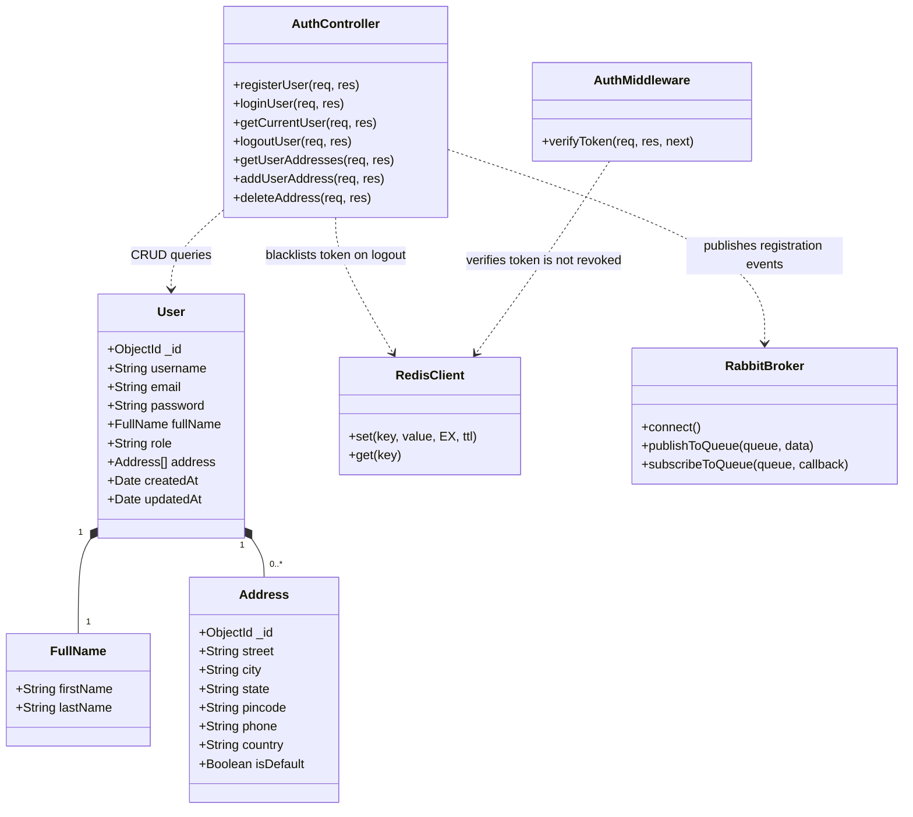

### Sequence Diagram — Registration & Event Broadcast

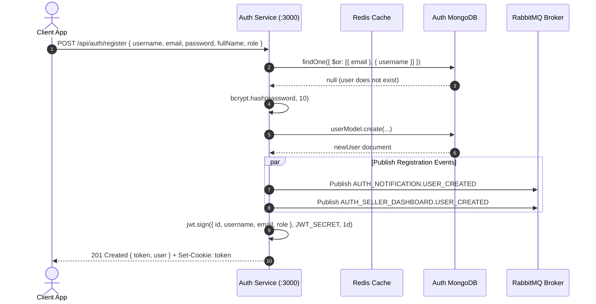

### API Endpoints

| Method | Endpoint | Auth Required | Role | Description |
| :--- | :--- | :---: | :---: | :--- |
| `POST` | `/api/auth/register` | No | Any | Register user or seller; publishes to notification and seller dashboard queues |
| `POST` | `/api/auth/login` | No | Any | Authenticate via email or username; sets HTTP cookie and returns JWT |
| `GET` | `/api/auth/me` | Yes | Any | Return profile of authenticated user |
| `GET` | `/api/auth/logout` | Yes | Any | Blacklists current token in Redis for remaining lifespan and clears cookie |
| `GET` | `/api/auth/users/me/address` | Yes | Any | List all saved shipping addresses |
| `POST` | `/api/auth/users/me/address` | Yes | Any | Add new shipping address to user profile |
| `DELETE` | `/api/auth/users/me/address/:addressID` | Yes | Any | Remove specific shipping address by subdocument ID |

---

## 2️⃣ Products Service (`Products/` — Port 3001)

The **Products Service** manages product catalogs, categories, pricing, full-text search, and multi-image uploads directly streamed to **ImageKit CDN**.

### UML Class Diagram

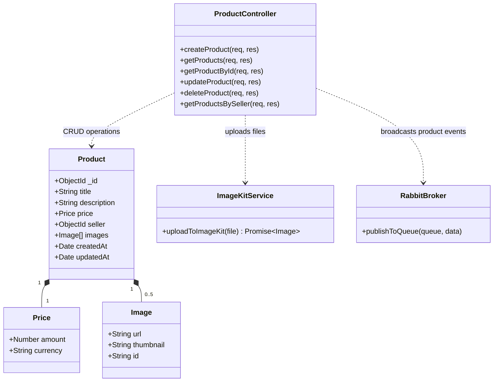

### Sequence Diagram — Create Product with ImageKit CDN

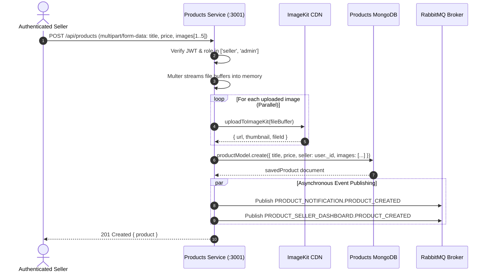

### API Endpoints

| Method | Endpoint | Auth | Role | Description |
| :--- | :--- | :---: | :---: | :--- |
| `POST` | `/api/products` | Yes | `seller`, `admin` | Create new product with up to 5 image uploads |
| `GET` | `/api/products` | No | Public | Search catalog with filters (`q`, `minPrice`, `maxPrice`, `skip`, `limit`) |
| `GET` | `/api/products/seller` | Yes | `seller` | List all products owned by current authenticated seller |
| `GET` | `/api/products/:id` | No | Public | Get single product by MongoDB ObjectId |
| `PATCH` | `/api/products/:id` | Yes | `seller` (owner) | Modify product title, description, pricing, or media |
| `DELETE` | `/api/products/:id` | Yes | `seller` (owner) | Delete product from catalog |

---

## 3️⃣ Cart Service (`Cart/` — Port 3002)

The **Cart Service** provides sessionless cart storage. It implements automatic cart creation (lazy provisioning), item merging, and auto-pruning. It operates **synchronously without RabbitMQ**.

### UML Class Diagram

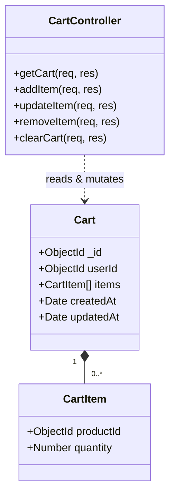

### Sequence Diagram — Add / Merge Item into Cart

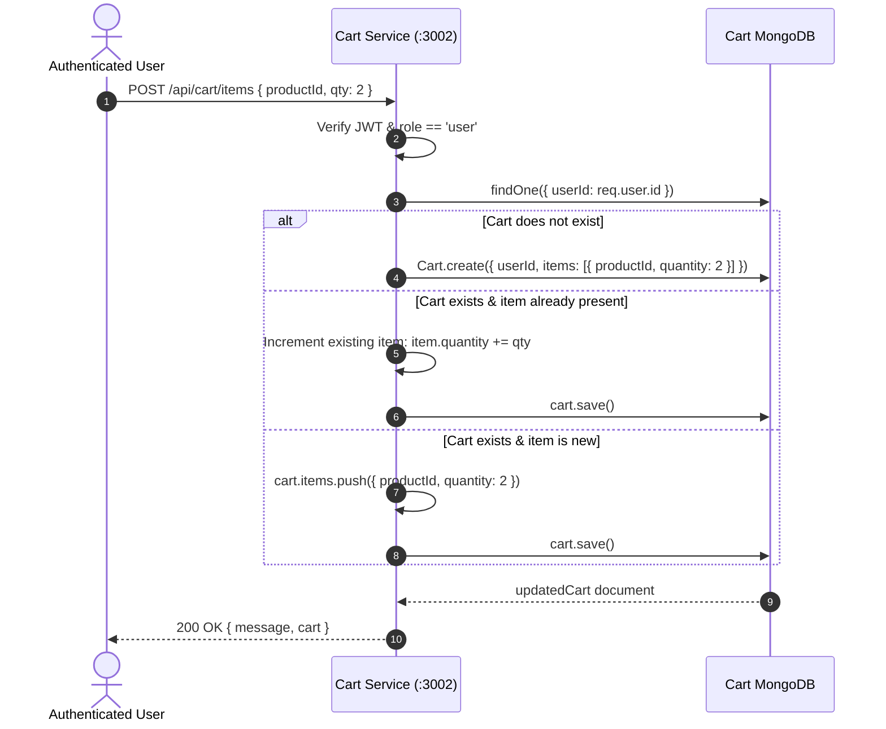

### API Endpoints

| Method | Endpoint | Auth | Role | Description |
| :--- | :--- | :---: | :---: | :--- |
| `GET` | `/api/cart` | Yes | `user` | Fetch customer's cart with computed `itemCount` and `totalQuantity` |
| `POST` | `/api/cart/items` | Yes | `user` | Add product to cart or increment quantity if already present |
| `PATCH` | `/api/cart/items/:productId` | Yes | `user` | Set explicit quantity; automatically prunes item if quantity `<= 0` |
| `DELETE` | `/api/cart/items/:productId` | Yes | `user` | Delete specific product from cart |
| `DELETE` | `/api/cart` | Yes | `user` | Clear all items from the customer's cart |

---

## 4️⃣ Order Service (`Order/` — Port 3003)

The **Order Service** manages the lifecycle of customer orders (`PENDING`, `CONFIRMED`, `SHIPPED`, `DELIVERED`, `CANCELLED`). It coordinates checkout by retrieving items from the Cart service, calling inventory reservation, and recording orders.

### UML Class Diagram

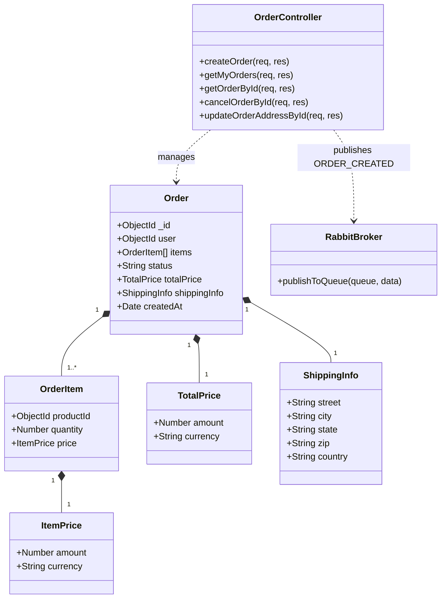

### Sequence Diagram — Order Creation & Inventory Reservation

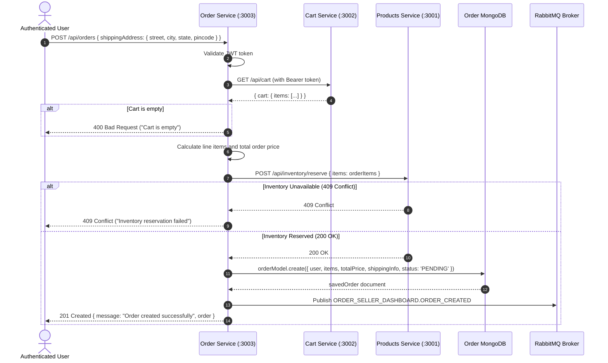

### API Endpoints

| Method | Endpoint | Auth | Role | Description |
| :--- | :--- | :---: | :---: | :--- |
| `POST` | `/api/orders` | Yes | `user` | Transform cart into an order, reserve inventory, publish event |
| `GET` | `/api/orders/me` | Yes | `user` | Retrieve paginated list of orders placed by customer |
| `GET` | `/api/orders/:id` | Yes | `user`, `admin` | Fetch single order by ID (verifies ownership or admin role) |
| `POST` | `/api/orders/:id/cancel` | Yes | `user` | Cancel an unfulfilled order (marks status `CANCELLED`) |
| `PATCH` | `/api/orders/:id/address` | Yes | `user` | Update delivery address (only permitted if status is `PENDING`) |

---

## 5️⃣ Payment Service (`Payment/` — Port 3004)

The **Payment Service** integrates with **Razorpay** to generate checkout orders and verify HMAC SHA256 payment signatures.

### UML Class Diagram

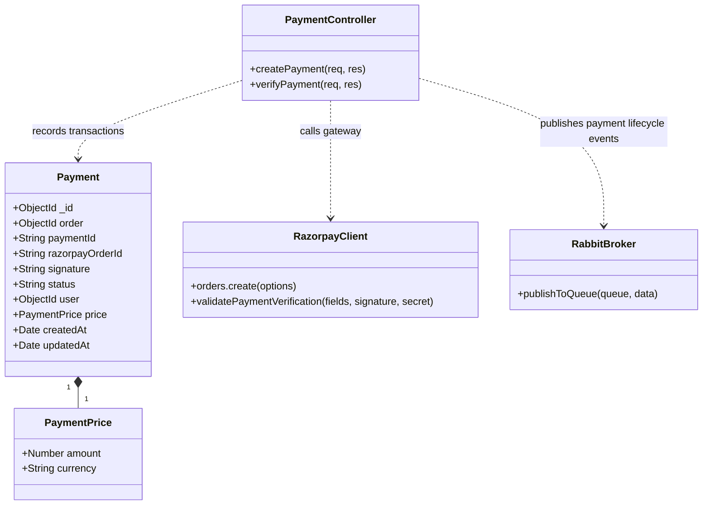

### Sequence Diagram — Payment Order Creation & Signature Verification

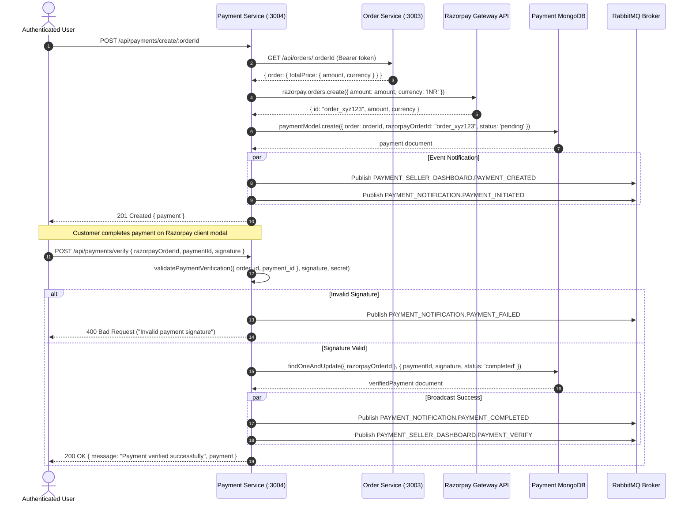

### API Endpoints

| Method | Endpoint | Auth | Role | Description |
| :--- | :--- | :---: | :---: | :--- |
| `POST` | `/api/payments/create/:orderId` | Yes | `user` | Fetch order amount, create Razorpay order, publish `PAYMENT_INITIATED` |
| `POST` | `/api/payments/verify` | Yes | `user` | Verify cryptographic HMAC signature, mark `completed`, publish events |

---

## 6️⃣ AI-Buddy Service (`AI-Buddy/` — Port 3005)

The **AI-Buddy Service** provides an intelligent conversational shopping agent using **Google Gemini 2.0 Flash** and **LangGraph**. It maintains chat state, invokes tools against Products and Cart services, and interacts over **Socket.IO**.

### UML Class Diagram

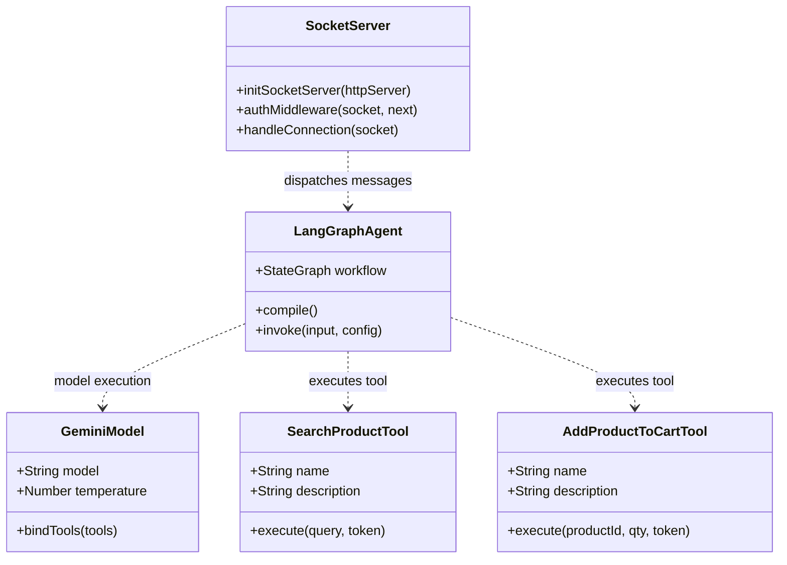

### Sequence Diagram — Conversational Tool Calling Workflow

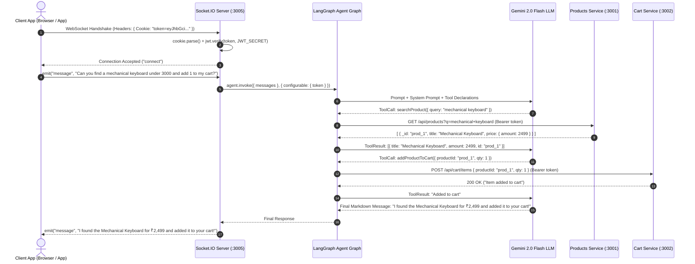

### Configuration & Notes

| Variable | Description | Default / Example |
| :--- | :--- | :--- |
| `PORT` | Listening port for HTTP and Socket.IO | `3005` |
| `GOOGLE_API_KEY` | Google Gemini Developer API Key | `AIzaSy...` |
| `JWT_SECRET` | Shared JWT secret used to decode client cookies | `your_shared_jwt_secret` |

> [!IMPORTANT]
> **Socket Authentication Mechanism**: The AI-Buddy Socket.IO server parses JWTs exclusively from the `Cookie` header during the initial HTTP handshake (`token=<jwt>`). Clients must ensure authentication cookies are forwarded during socket connection initialization.

---

## 7️⃣ Notification Service (`Notification/` — Port 3006)

The **Notification Service** is a pure event-driven consumer without public REST endpoints (except for a `/` health check). It listens to RabbitMQ queues and sends transactional emails using **Nodemailer** backed by **Google OAuth2**.

### UML Class Diagram

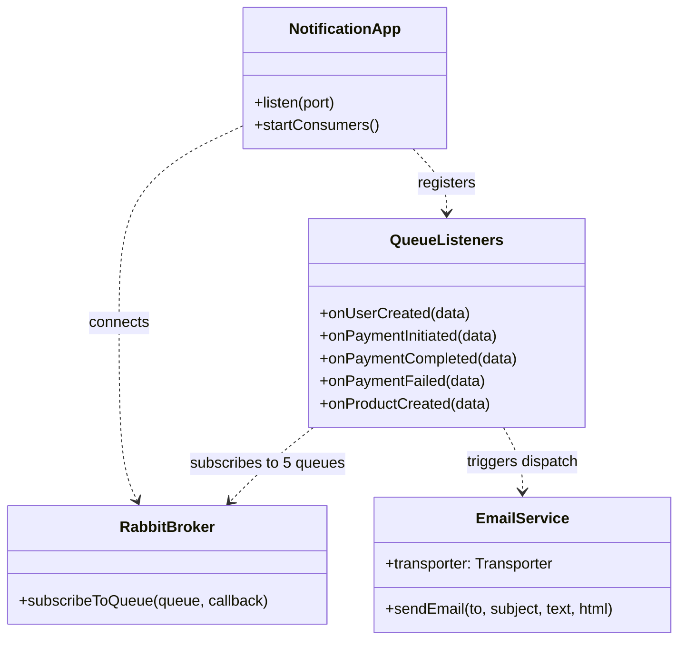

### Event Consumer Matrix & Email Templates

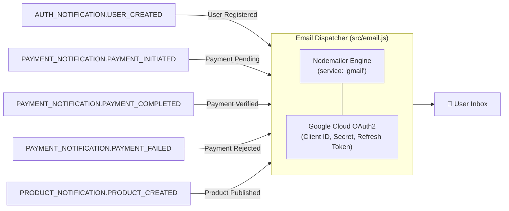

| Event Queue Name | Subject Line | Rendered Content Summary |
| :--- | :--- | :--- |
| `AUTH_NOTIFICATION.USER_CREATED` | *Welcome to our Service* | Greets user by username / full name; confirms successful registration |
| `PAYMENT_NOTIFICATION.PAYMENT_INITIATED` | *Payment Initiated* | Notifies that payment has been created with Order ID, Payment ID, and Amount |
| `PAYMENT_NOTIFICATION.PAYMENT_COMPLETED` | *Payment Completed* | Confirms receipt of funds with Order ID, Payment ID, and Amount |
| `PAYMENT_NOTIFICATION.PAYMENT_FAILED` | *Payment Failed* | Alerts customer that payment verification failed with Order ID and Payment ID |
| `PRODUCT_NOTIFICATION.PRODUCT_CREATED` | *Product Available* | Informs seller/admin of new product catalog listing |

---

## 8️⃣ Seller-Dashboard Service (`Seller-Dashboard/` — Port 3007)

The **Seller-Dashboard Service** implements the **CQRS Read-Model** pattern. Instead of executing cross-database joins against live transactional databases, it listens to domain events from Auth, Products, Order, and Payment services and persists denormalized replica documents in its own database. It provides high-performance analytical queries.

### UML Class Diagram

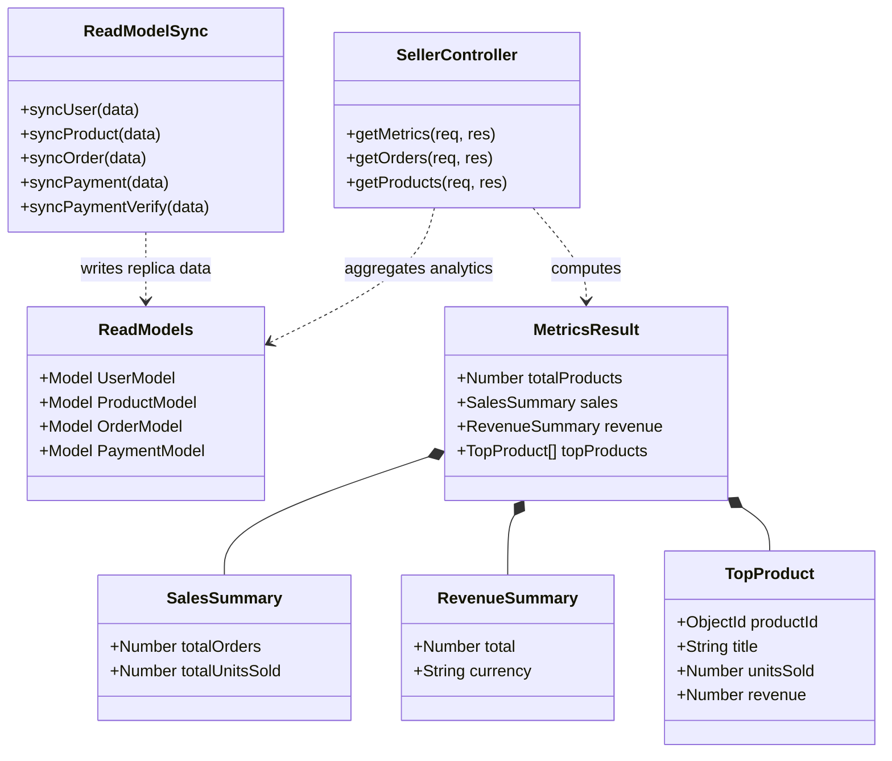

### Sequence Diagram — CQRS Read Synchronization & Metrics Query

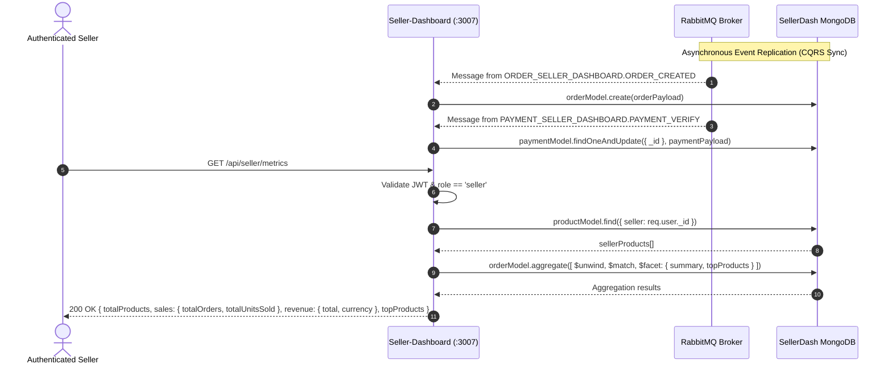

### API Endpoints

| Method | Endpoint | Auth | Role | Description |
| :--- | :--- | :---: | :---: | :--- |
| `GET` | `/api/seller/metrics` | Yes | `seller` | Aggregated dashboard metrics: units sold, gross revenue, top products |
| `GET` | `/api/seller/orders` | Yes | `seller` | Orders containing items belonging to authenticated seller |
| `GET` | `/api/seller/products` | Yes | `seller` | Products registered by seller stored in the local read-model |

---

## 🗄️ Database Schemas

### 1. Auth Service — User & Embedded Address
```javascript
const addressSchema = new mongoose.Schema({
    street:    { type: String },
    city:      { type: String },
    state:     { type: String },
    pincode:   { type: String },
    phone:     { type: String },
    country:   { type: String, default: 'India' },
    isDefault: { type: Boolean, default: false }
});

const userSchema = new mongoose.Schema({
    username: { type: String, required: true, unique: true, lowercase: true },
    email:    { type: String, required: true, unique: true, lowercase: true },
    password: { type: String, required: true, select: false },
    fullName: {
        firstName: { type: String, required: true },
        lastName:  { type: String }
    },
    role:     { type: String, enum: ['user', 'seller'], default: 'user' },
    address:  [addressSchema]
}, { timestamps: true });
```

### 2. Products Service — Product with Text Index
```javascript
const productSchema = new mongoose.Schema({
    title:       { type: String, required: true, trim: true },
    description: { type: String, default: '' },
    price: {
        amount:   { type: Number, required: true },
        currency: { type: String, enum: ['INR', 'USD'], default: 'INR' }
    },
    seller:      { type: mongoose.Schema.Types.ObjectId, required: true },
    images: [{
        url:       { type: String },
        thumbnail: { type: String },
        id:        { type: String }
    }]
}, { timestamps: true });

productSchema.index({ title: 'text', description: 'text' });
```

### 3. Cart Service — Cart & Dynamic Line Items
```javascript
const cartSchema = new mongoose.Schema({
    userId: { type: mongoose.Schema.Types.ObjectId, required: true },
    items: [{
        productId: { type: mongoose.Schema.Types.ObjectId, required: true },
        quantity:  { type: Number, required: true, min: 1 }
    }]
}, { timestamps: true });
```

### 4. Order Service — Order & Snapshot Pricing
```javascript
const orderSchema = new mongoose.Schema({
    user: { type: mongoose.Schema.Types.ObjectId, required: true },
    items: [{
        productId: { type: mongoose.Schema.Types.ObjectId, required: true },
        quantity:  { type: Number, required: true },
        price: {
            amount:   { type: Number, required: true },
            currency: { type: String, enum: ['INR', 'USD'], default: 'INR' }
        }
    }],
    status: {
        type: String,
        enum: ['PENDING', 'CONFIRMED', 'SHIPPED', 'DELIVERED', 'CANCELLED'],
        default: 'PENDING'
    },
    totalPrice: {
        amount:   { type: Number, required: true },
        currency: { type: String, enum: ['INR', 'USD'], default: 'INR' }
    },
    shippingInfo: {
        street:  { type: String },
        city:    { type: String },
        state:   { type: String },
        zip:     { type: String },
        country: { type: String, default: 'India' }
    }
}, { timestamp: true }); // Note: source code specifies 'timestamp: true'
```

### 5. Payment Service — Transaction Records
```javascript
const paymentSchema = new mongoose.Schema({
    order:           { type: mongoose.Schema.Types.ObjectId, required: true },
    paymentId:       { type: String },
    razorpayOrderId: { type: String, required: true },
    signature:       { type: String },
    status:          { type: String, enum: ['pending', 'completed', 'failed'], default: 'pending' },
    user:            { type: mongoose.Schema.Types.ObjectId, required: true },
    price: {
        amount:   { type: Number, required: true },
        currency: { type: String, enum: ['INR', 'USD'], default: 'INR' }
    }
}, { timestamps: true });
```

---

## ⚙️ Getting Started

### Prerequisites

Ensure the following tools and infrastructure are installed and accessible:
- [Node.js](https://nodejs.org/) `>= 18.0.0` and `npm`
- [MongoDB](https://www.mongodb.com/) (Local instance or MongoDB Atlas replica set)
- [Redis](https://redis.io/) (for Auth session blacklist)
- [RabbitMQ](https://www.rabbitmq.com/) (AMQP broker with default port `5672`)
- [ImageKit.io Account](https://imagekit.io/) (Products service CDN)
- [Razorpay Account](https://razorpay.com/) (Test Key ID & Key Secret)
- [Google Cloud Console Project](https://console.cloud.google.com/) (OAuth2 credentials for Gmail API)
- [Google AI Studio API Key](https://ai.google.dev/) (Gemini 2.0 Flash)

### Infrastructure Setup via Docker

To run the supporting databases and brokers locally:

```bash
# Start MongoDB, Redis, and RabbitMQ with Management UI
docker run -d --name vendora-mongo -p 27017:27017 mongo:6.0
docker run -d --name vendora-redis -p 6379:6379 redis:7-alpine
docker run -d --name vendora-rabbit -p 5672:5672 -p 15672:15672 rabbitmq:3-management
```

*RabbitMQ Management Dashboard will be available at `http://localhost:15672` (default user: `guest` / `guest`).*

### Repository Setup

```bash
git clone https://github.com/itsam-13/Vendora.git
cd Vendora
```

### Environment Configuration

Create a `.env` file in each individual service directory based on the reference templates below:

<details>
<summary><b>Click to expand .env templates for all 8 services</b></summary>

#### `Auth/.env`
```ini
PORT=3000
NODE_ENV=development
MONGO_URI=mongodb://localhost:27017/VendoraAuth
JWT_SECRET_KEY=shared_super_secret_jwt_key_vendora_2026
REDIS_HOST=127.0.0.1
REDIS_PORT=6379
REDIS_PASSWORD=
RABBIT_URL=amqp://localhost
```

#### `Products/.env`
```ini
PORT=3001
NODE_ENV=development
MONGO_URI=mongodb://localhost:27017/VendoraProducts
JWT_SECRET_KEY=shared_super_secret_jwt_key_vendora_2026
IMAGEKIT_PUBLIC_KEY=your_imagekit_public_key
IMAGEKIT_PRIVATE_KEY=your_imagekit_private_key
IMAGEKIT_URL_ENDPOINT=https://ik.imagekit.io/your_endpoint
RABBIT_URL=amqp://localhost
```

#### `Cart/.env`
```ini
PORT=3002
NODE_ENV=development
MONGO_URI=mongodb://localhost:27017/VendoraCart
JWT_SECRET_KEY=shared_super_secret_jwt_key_vendora_2026
```

#### `Order/.env`
```ini
PORT=3003
NODE_ENV=development
MONGO_URI=mongodb://localhost:27017/VendoraOrder
JWT_SECRET_KEY=shared_super_secret_jwt_key_vendora_2026
RABBIT_URL=amqp://localhost
CART_SERVICE_URL=http://localhost:3002
INVENTORY_SERVICE_URL=http://localhost:3001
```

#### `Payment/.env`
```ini
PORT=3004
NODE_ENV=development
MONGO_URI=mongodb://localhost:27017/VendoraPayment
JWT_SECRET_KEY=shared_super_secret_jwt_key_vendora_2026
RABBIT_URL=amqp://localhost
RAZORPAY_KEY_ID=rzp_test_YourTestKeyIdHere
RAZORPAY_KEY_SECRET=YourRazorpaySecretKeyHere
ORDER_SERVICE_URL=http://localhost:3003
```

#### `AI-Buddy/.env`
```ini
PORT=3005
GOOGLE_API_KEY=AIzaSyYourGeminiApiKeyHere
JWT_SECRET=shared_super_secret_jwt_key_vendora_2026
```

#### `Notification/.env`
```ini
PORT=3006
RABBIT_URL=amqp://localhost
EMAIL_USER=your_verified_gmail@gmail.com
CLIENT_ID=your_google_cloud_oauth_client_id.apps.googleusercontent.com
CLIENT_SECRET=your_google_cloud_oauth_client_secret
REFRESH_TOKEN=your_google_cloud_oauth_refresh_token
```

#### `Seller-Dashboard/.env`
```ini
PORT=3007
NODE_ENV=development
MONGO_URI=mongodb://localhost:27017/VendoraSellerDash
JWT_SECRET_KEY=shared_super_secret_jwt_key_vendora_2026
RABBIT_URL=amqp://localhost
```

</details>

> [!IMPORTANT]
> **Shared JWT Secret**: All services (`Auth`, `Products`, `Cart`, `Order`, `Payment`, `AI-Buddy`, `Seller-Dashboard`) must share the exact same `JWT_SECRET_KEY` (or `JWT_SECRET`) so tokens signed by `Auth` can be independently validated by downstream services without network roundtrips.

---

### Starting Services

You can start each service in separate terminal instances:

```bash
# Terminal 1: Auth Service (Port 3000)
cd Auth && npm install && npm run dev

# Terminal 2: Products Service (Port 3001)
cd Products && npm install && npm run dev

# Terminal 3: Cart Service (Port 3002)
cd Cart && npm install && npm run dev

# Terminal 4: Order Service (Port 3003)
cd Order && npm install && npm run dev

# Terminal 5: Payment Service (Port 3004)
cd Payment && npm install && npm run dev

# Terminal 6: AI-Buddy Service (Port 3005)
cd AI-Buddy && npm install && npm run dev

# Terminal 7: Notification Service (Port 3006)
cd Notification && npm install && npm run dev

# Terminal 8: Seller-Dashboard Service (Port 3007)
cd Seller-Dashboard && npm install && npm run dev
```

---

## 🧪 Testing Suite

Vendora includes a comprehensive automated test suite with **132 automated tests** across **8 test suites** using **Jest**, **Supertest**, and in-memory mock databases.

| Service | Test File Location | Suites | Tests | Status |
| :--- | :--- | :---: | :---: | :---: |
| **Auth** | `Auth/tests/` | 5 | 34 | ✅ All Passing |
| **Products** | `Products/tests/` | 1 | 50 | ✅ All Passing |
| **Cart** | `Cart/tests/` | 1 | 29 | ✅ All Passing |
| **Order** | `Order/tests/order.test.js` | 1 | 19 | ✅ All Passing |
| **Total** | | **8** | **132** | **100% Pass Rate** |

### Running the Test Suites

```bash
# Run Auth service integration tests
cd Auth && npm test

# Run Products catalog & media tests
cd Products && npm test

# Run Cart service logic tests
cd Cart && npm test

# Run Order orchestration tests
cd Order && npm test
```

---

## ⚠️ Architecture Gotchas & Implementation Notes

| Area | Component | Implementation Detail / Caution |
| :--- | :--- | :--- |
| **Order Schema Timestamps** | `Order/src/models/order.model.js` | The schema defines `{ timestamp: true }` (singular) rather than `{ timestamps: true }`. Consequently, Mongoose does not automatically attach `createdAt` or `updatedAt` properties. |
| **AI-Buddy Tool Protocols** | `AI-Buddy/src/agent/tool.js` | The search and cart tool functions target `https://localhost:3001` and `https://localhost:3002`. In standard local dev running over HTTP, configure an HTTPS reverse proxy (e.g. Caddy/Nginx) or align URLs to `http://`. |
| **Notification Port Binding** | `Notification/server.js` | The server file explicitly hardcodes `app.listen('3006', ...)`, bypassing any `process.env.PORT` variable assigned in `.env`. |
| **Order Inventory Route** | `Order/src/controller/order.controller.js` | Order creation calls `POST /api/inventory/reserve` on the Products service. This route is mocked during Order unit tests; in a live deployment, provide an inventory reservation handler on Products or an API Gateway. |
| **AI-Buddy Handshake Auth** | `AI-Buddy/src/sockets/socket.server.js` | Authentication verifies only the `Cookie` header (`cookie.parse(socket.handshake.headers.cookie).token`). Passing tokens via socket handshake `auth: { token }` is not parsed by current middleware. |
| **Seller-Dashboard Port Log** | `Seller-Dashboard/server.js` | `server.js` listens on `process.env.PORT` but hardcodes the message `"Seller Dashboard is running at 3007"` in the console callback. |

---

## 🗺️ Roadmap & Future Enhancements

- [X] **Microservices Decoupling**: 8 autonomous services with isolated databases.
- [X] **Event-Driven Messaging**: Asynchronous event publishing with RabbitMQ durable queues.
- [X] **CQRS Seller Analytics**: Aggregated metrics calculation without impacting transactional DBs.
- [X] **AI Shopping Agent**: Multi-turn tool calling with Google Gemini 2.0 Flash and LangGraph.
- [X] **Automated Test Coverage**: 132 integration tests across Auth, Products, Cart, and Order.
- [ ] **Unified API Gateway**: Implement KrakenD, Kong, or Express Gateway for central routing, rate limiting, and SSL termination.
- [ ] **Dedicated Inventory Service**: Extract stock reservation into an autonomous high-throughput service.
- [ ] **Docker Compose Orchestration**: Unified multi-container `docker-compose.yml` for single-command developer bootstrapping.
- [ ] **Review & Rating Microservice**: Customer product evaluations and sentiment analysis.
- [ ] **Kubernetes Deployment Manifests**: Helm charts for production cluster orchestration.

---

## 📄 License

This project is licensed under the [ISC License](LICENSE).
