<div align="center">

---

## 📌 Project Overview

**Vendora** is an enterprise-ready, multi-vendor e-commerce platform built as a distributed microservices system. Each service is independently deployable, communicates asynchronously via **RabbitMQ**, and is isolated behind its own database. The platform handles high-concurrency traffic, secure transactional workflows, event-driven notifications, AI-powered shopping assistance, and seller-specific analytics.

### 🏗️ Services at a Glance

| # | Service                    |   Port   | Description                                                    |
| :- | :------------------------- | :------: | :------------------------------------------------------------- |
| 1 | **Auth**             | `3000` | Identity, JWT auth, Redis session revocation, address book     |
| 2 | **Products**         | `3001` | Product catalog, RBAC, ImageKit CDN, full-text search          |
| 3 | **Cart**             | `3002` | Customer shopping cart, quantity management, auto-provisioning |
| 4 | **Order**            | `3003` | Order lifecycle, inventory reservation, shipping management    |
| 5 | **Payment**          | `3004` | Razorpay integration, payment creation & verification          |
| 6 | **AI-Buddy**         | `3005` | Gemini 2.0 Flash AI agent with Socket.IO real-time chat        |
| 7 | **Notification**     | `3006` | Event-driven email notifications via Nodemailer + Gmail OAuth2 |
| 8 | **Seller-Dashboard** | `3007` | Seller analytics, read-model via RabbitMQ event sync           |

---

## 🏛️ System Architecture

```mermaid
graph TB
    Client["🌐 Client"]

    subgraph Services["Microservices (REST + WebSocket)"]
        Auth["Auth :3000"]
        Products["Products :3001"]
        Cart["Cart :3002"]
        Order["Order :3003"]
        Payment["Payment :3004"]
        AIBuddy["AI-Buddy :3005"]
        Notification["Notification :3006"]
        SellerDash["Seller-Dashboard :3007"]
    end

    subgraph MQ["📨 RabbitMQ Message Broker"]
        Q1["AUTH_NOTIFICATION.USER_CREATED"]
        Q2["AUTH_SELLER_DASHBOARD.USER_CREATED"]
        Q3["PRODUCT_NOTIFICATION.PRODUCT_CREATED"]
        Q4["PRODUCT_SELLER_DASHBOARD.PRODUCT_CREATED"]
        Q5["ORDER_SELLER_DASHBOARD.ORDER_CREATED"]
        Q6["PAYMENT_NOTIFICATION.PAYMENT_events"]
        Q7["PAYMENT_SELLER_DASHBOARD.PAYMENT_events"]
    end

    subgraph External["🔧 External Services"]
        MongoDB[("MongoDB")]
        Redis[("Redis")]
        ImageKit["ImageKit CDN"]
        Razorpay["Razorpay"]
        Gmail["Gmail SMTP"]
        GeminiAI["Gemini 2.0 Flash"]
    end

    Client -->|HTTP| Auth
    Client -->|HTTP| Products
    Client -->|HTTP| Cart
    Client -->|HTTP| Order
    Client -->|HTTP| Payment
    Client -->|WebSocket| AIBuddy

    Auth -->|Publishes| Q1
    Auth -->|Publishes| Q2
    Products -->|Publishes| Q3
    Products -->|Publishes| Q4
    Order -->|Publishes| Q5
    Payment -->|Publishes| Q6
    Payment -->|Publishes| Q7

    Q1 -->|Subscribes| Notification
    Q3 -->|Subscribes| Notification
    Q6 -->|Subscribes| Notification
    Q2 -->|Subscribes| SellerDash
    Q4 -->|Subscribes| SellerDash
    Q5 -->|Subscribes| SellerDash
    Q7 -->|Subscribes| SellerDash

    Order -->|"HTTP GET /api/cart"| Cart
    Order -->|"HTTP POST /api/inventory/reserve"| Products
    Payment -->|"HTTP GET /api/orders/:id"| Order
    AIBuddy -->|"HTTP GET /api/products"| Products
    AIBuddy -->|"HTTP POST /api/cart/items"| Cart

    Auth --- MongoDB
    Products --- MongoDB
    Cart --- MongoDB
    Order --- MongoDB
    Payment --- MongoDB
    SellerDash --- MongoDB
    Auth --- Redis
    Products --- ImageKit
    Payment --- Razorpay
    Notification --- Gmail
    AIBuddy --- GeminiAI
```

### 🔁 Inter-Service Communication

- **Synchronous (REST HTTP)**: Client ↔ Services; Order → Cart; Order → Products; Payment → Order; AI-Buddy → Products + Cart
- **Asynchronous (RabbitMQ)**: Auth/Products/Order/Payment publish → Notification/Seller-Dashboard consume

---

## 📦 RabbitMQ Event Topology

| Publisher | Queue Name                                   | Consumer         | Payload                                                     |
| :-------- | :------------------------------------------- | :--------------- | :---------------------------------------------------------- |
| Auth      | `AUTH_NOTIFICATION.USER_CREATED`           | Notification     | `{id, username, email, fullName}`                         |
| Auth      | `AUTH_SELLER_DASHBOARD.USER_CREATED`       | Seller-Dashboard | Full user document                                          |
| Products  | `PRODUCT_NOTIFICATION.PRODUCT_CREATED`     | Notification     | `{username, email, title}`                                |
| Products  | `PRODUCT_SELLER_DASHBOARD.PRODUCT_CREATED` | Seller-Dashboard | Full product document                                       |
| Order     | `ORDER_SELLER_DASHBOARD.ORDER_CREATED`     | Seller-Dashboard | Full order document                                         |
| Payment   | `PAYMENT_NOTIFICATION.PAYMENT_INITIATED`   | Notification     | `{email, orderId, paymentId, amount, currency, username}` |
| Payment   | `PAYMENT_NOTIFICATION.PAYMENT_COMPLETED`   | Notification     | `{email, orderId, paymentId, amount, currency, username}` |
| Payment   | `PAYMENT_NOTIFICATION.PAYMENT_FAILED`      | Notification     | `{email, paymentId, orderId, username}`                   |
| Payment   | `PAYMENT_SELLER_DASHBOARD.PAYMENT_CREATED` | Seller-Dashboard | Full payment document                                       |
| Payment   | `PAYMENT_SELLER_DASHBOARD.PAYMENT_VERIFY`  | Seller-Dashboard | Updated payment document                                    |

---

## 📂 Full Project Structure

```text
Vendora/
├── README.md
├── Auth/                           # Authentication & Identity Service (Port 3000)
│   ├── server.js
│   ├── jest.config.js
│   ├── Src/
│   │   ├── app.js
│   │   ├── broker/broker.js        # RabbitMQ publish/subscribe client
│   │   ├── Controllers/auth.controller.js
│   │   ├── DataBase/
│   │   │   ├── db.js
│   │   │   └── redis.js
│   │   ├── MiddleWare/
│   │   │   ├── auth.middleware.js
│   │   │   └── validator.middleware.js
│   │   ├── Model/user.model.js
│   │   └── Routes/auth.routes.js
│   └── tests/                      # 34 integration tests
├── Products/                       # Product Catalog & Media Service (Port 3001)
│   ├── server.js
│   ├── jest.config.js
│   ├── src/
│   │   ├── app.js
│   │   ├── broker/broker.js
│   │   ├── controllers/product.controller.js
│   │   ├── database/db.js
│   │   ├── middlewares/
│   │   │   ├── auth.middleware.js
│   │   │   ├── multer.middleware.js
│   │   │   └── validator.middleware.js
│   │   ├── models/product.model.js
│   │   ├── routes/product.routes.js
│   │   └── services/imagekit.service.js
│   └── tests/                      # 50 integration tests
├── Cart/                           # Shopping Cart Service (Port 3002)
│   ├── server.js
│   ├── jest.config.js
│   ├── src/
│   │   ├── app.js
│   │   ├── controllers/cart.controller.js
│   │   ├── database/db.js
│   │   ├── middlewares/
│   │   │   ├── auth.middleware.js
│   │   │   └── validator.middleware.js
│   │   ├── model/cart.model.js
│   │   └── routes/cart.routes.js
│   └── tests/                      # 29 integration tests
├── Order/                          # Order Management Service (Port 3003)
│   ├── server.js
│   ├── jest.config.js
│   ├── src/
│   │   ├── app.js
│   │   ├── broker/broker.js
│   │   ├── controller/order.controller.js
│   │   ├── database/db.js
│   │   ├── middleware/
│   │   │   ├── auth.middleware.js
│   │   │   └── validation.middleware.js
│   │   ├── models/order.model.js
│   │   └── routes/order.routes.js
│   └── tests/
├── Payment/                        # Payment Gateway Service (Port 3004)
│   ├── server.js
│   └── src/
│       ├── app.js
│       ├── broker/broker.js
│       ├── controller/payment.controller.js
│       ├── database/db.js
│       ├── middleware/auth.middleware.js
│       ├── model/payment.model.js
│       └── routes/payment.routes.js
├── AI-Buddy/                       # AI Shopping Assistant Service (Port 3005)
│   ├── server.js
│   └── src/
│       ├── app.js
│       ├── agent/
│       │   ├── agent.js            # LangGraph state machine + Gemini 2.0 Flash
│       │   └── tool.js             # searchProduct & addProductToCart tools
│       └── sockets/
│           └── socket.server.js    # Socket.IO + JWT auth middleware
├── Notification/                   # Notification Service (Port 3006)
│   ├── server.js
│   └── src/
│       ├── app.js
│       ├── email.js                # Nodemailer + Gmail OAuth2
│       └── broker/
│           ├── broker.js
│           └── listners.js         # Queue subscribers → email dispatch
└── Seller-Dashboard/               # Seller Analytics Service (Port 3007)
    ├── server.js
    └── src/
        ├── app.js
        ├── broker/
        │   ├── broker.js
        │   └── listener.js         # Queue subscribers → local DB sync
        ├── controller/seller.controller.js
        ├── database/db.js
        ├── middleWare/auth.middleware.js
        ├── models/
        │   ├── user.model.js       # Read-model replica
        │   ├── product.model.js    # Read-model replica
        │   ├── order.model.js      # Read-model replica
        │   └── payment.model.js    # Read-model replica
        └── routes/seller.routes.js
```

---

## 🛠️ Technology Stack

| Layer                       | Technology                   | Details                                        |
| :-------------------------- | :--------------------------- | :--------------------------------------------- |
| **Runtime**           | Node.js >= 18                | Asynchronous, event-driven JavaScript runtime  |
| **Framework**         | Express.js 5.x               | Native async error propagation                 |
| **Database**          | MongoDB + Mongoose 9.x       | Isolated DB per service; compound text indexes |
| **Cache / Blacklist** | Redis (ioredis 6.x)          | JWT token revocation in Auth service           |
| **Message Broker**    | RabbitMQ (amqplib 2.x)       | Durable queues, at-least-once delivery         |
| **Media Storage**     | ImageKit SDK 6.x             | Cloud CDN for product images                   |
| **File Upload**       | Multer 2.x                   | In-memory multipart streaming                  |
| **Payments**          | Razorpay SDK                 | Order creation + HMAC signature verification   |
| **AI / LLM**          | Gemini 2.0 Flash + LangGraph | Agentic shopping assistant                     |
| **Real-time**         | Socket.IO 4.x                | WebSocket layer for AI-Buddy                   |
| **Email**             | Nodemailer + Gmail OAuth2    | Transactional email delivery                   |
| **Auth**              | JWT + bcryptjs               | Stateless sessions + salted hashing            |
| **Validation**        | express-validator 7.x        | Declarative request schema validation          |
| **Testing**           | Jest + Supertest             | In-memory MongoDB, mock external services      |

---

## 1️⃣ Auth Service (`Auth/` — Port 3000)

Handles user registration, login, logout, profile retrieval, and shipping address management. Publishes RabbitMQ events on registration for downstream services.

### UML Class Diagram

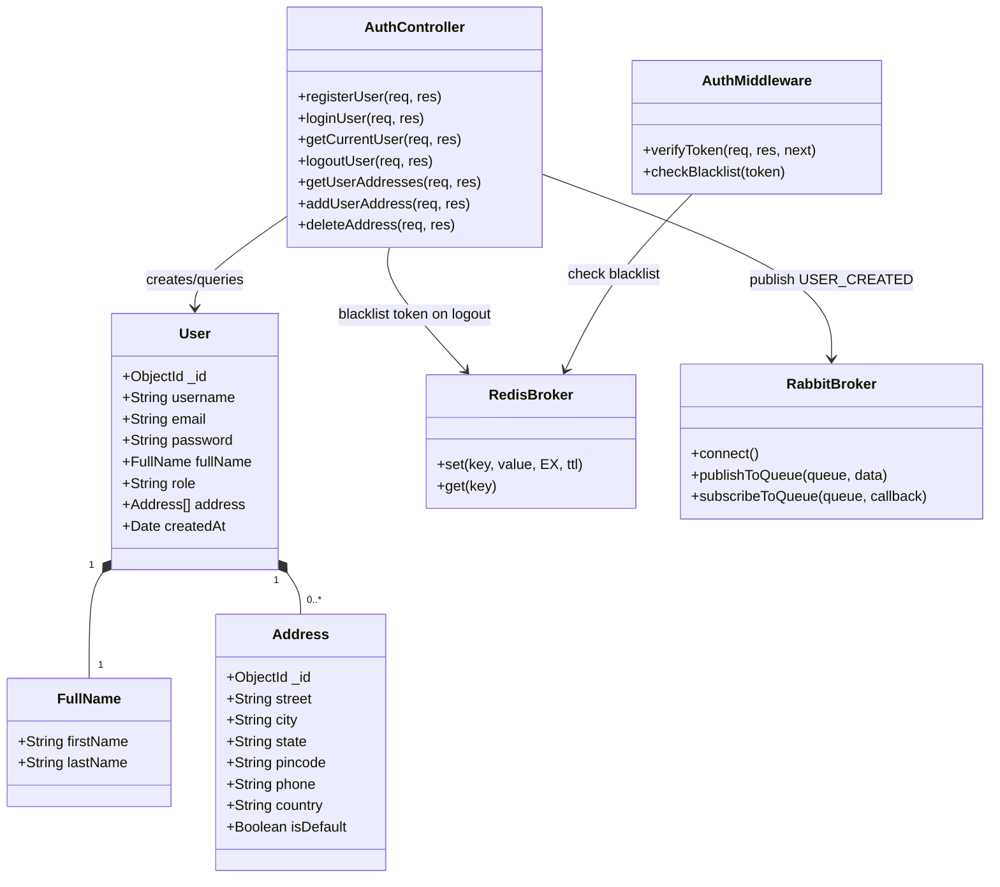

### Sequence Diagram — Registration

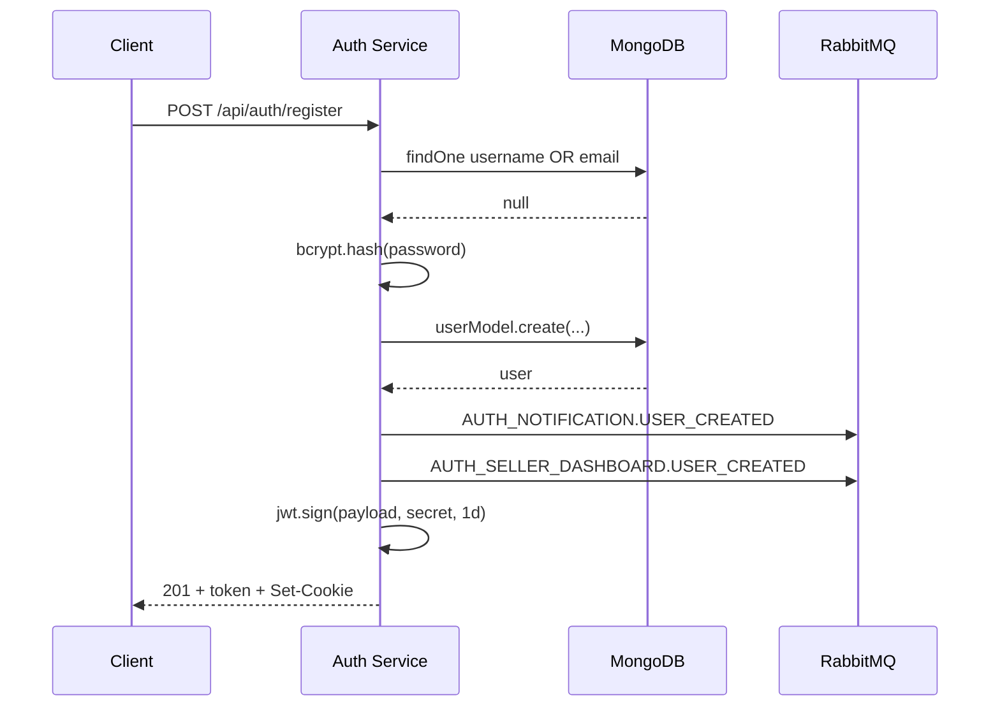

### API Endpoints

| Method     | Endpoint                                  | Auth | Role | Description                    |
| :--------- | :---------------------------------------- | :--: | :--: | :----------------------------- |
| `POST`   | `/api/auth/register`                    |  No  | Any | Register new user/seller       |
| `POST`   | `/api/auth/login`                       |  No  | Any | Login with email or username   |
| `GET`    | `/api/auth/me`                          | Yes | Any | Retrieve authenticated profile |
| `GET`    | `/api/auth/logout`                      | Yes | Any | Blacklist token, clear cookie  |
| `GET`    | `/api/auth/users/me/address`            | Yes | Any | List shipping addresses        |
| `POST`   | `/api/auth/users/me/address`            | Yes | Any | Add shipping address           |
| `DELETE` | `/api/auth/users/me/address/:addressID` | Yes | Any | Delete address by ID           |

### Events Published

| Queue                                  | Trigger         | Consumers        |
| :------------------------------------- | :-------------- | :--------------- |
| `AUTH_NOTIFICATION.USER_CREATED`     | On registration | Notification     |
| `AUTH_SELLER_DASHBOARD.USER_CREATED` | On registration | Seller-Dashboard |

---

## 2️⃣ Products Service (`Products/` — Port 3001)

End-to-end product lifecycle management with ImageKit cloud CDN integration, full-text search, RBAC creation, and seller ownership isolation.

### UML Class Diagram

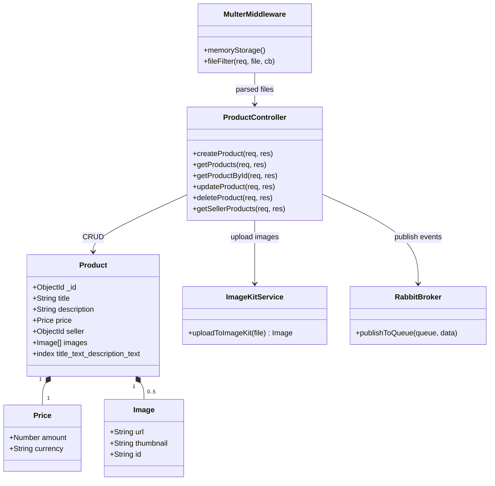

### Sequence Diagram — Create Product with Images

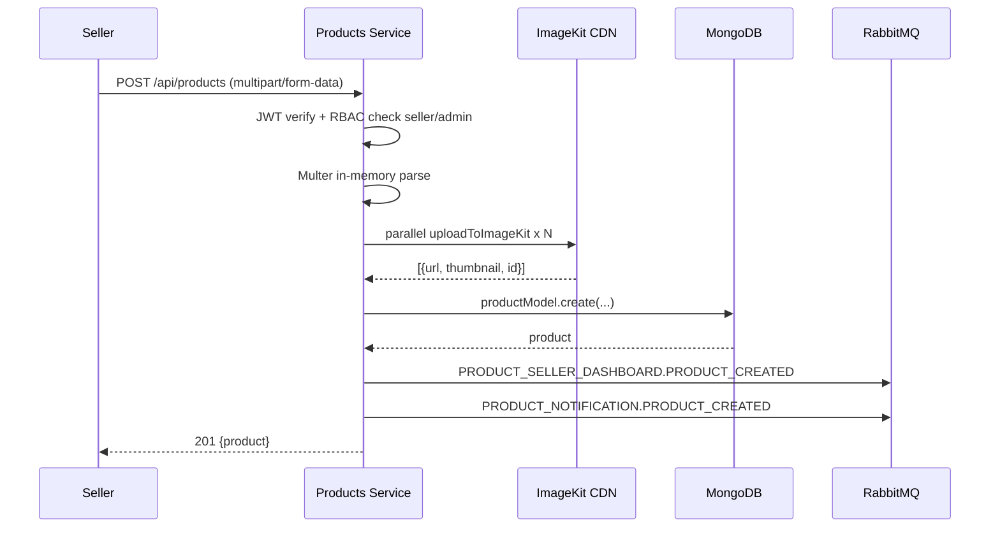

### API Endpoints

| Method     | Endpoint                 | Auth |         Role         | Description                                       |
| :--------- | :----------------------- | :--: | :-------------------: | :------------------------------------------------ |
| `POST`   | `/api/products`        | Yes | `seller`, `admin` | Create product with optional images               |
| `GET`    | `/api/products`        |  No  |        Public        | Browse catalog (search, price filter, pagination) |
| `GET`    | `/api/products/seller` | Yes |      `seller`      | List seller's own products                        |
| `GET`    | `/api/products/:id`    |  No  |        Public        | Fetch single product details                      |
| `PATCH`  | `/api/products/:id`    | Yes |   `seller` owner   | Update product fields                             |
| `DELETE` | `/api/products/:id`    | Yes |   `seller` owner   | Delete product                                    |

**Query params for `GET /api/products`:** `q`, `minPrice`, `maxPrice`, `skip`, `limit`

### Events Published

| Queue                                        | Trigger           | Consumers        |
| :------------------------------------------- | :---------------- | :--------------- |
| `PRODUCT_NOTIFICATION.PRODUCT_CREATED`     | On product create | Notification     |
| `PRODUCT_SELLER_DASHBOARD.PRODUCT_CREATED` | On product create | Seller-Dashboard |

---

## 3️⃣ Cart Service (`Cart/` — Port 3002)

Customer-only cart management with on-demand auto-provisioning, smart quantity merging, auto-pruning when qty <= 0, and live computed totals.

### UML Class Diagram

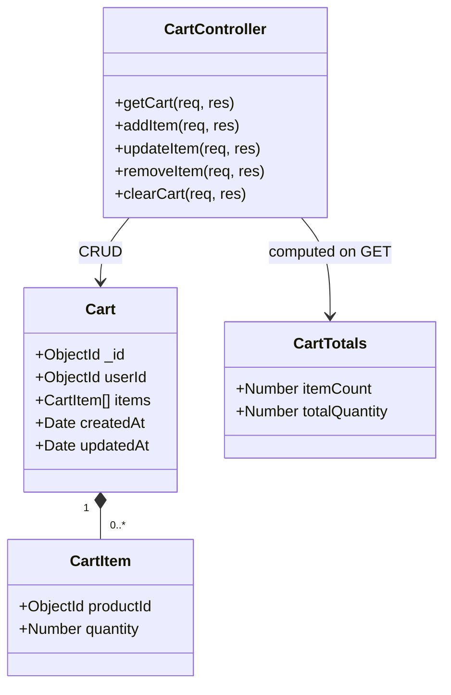

### Sequence Diagram — Add Item

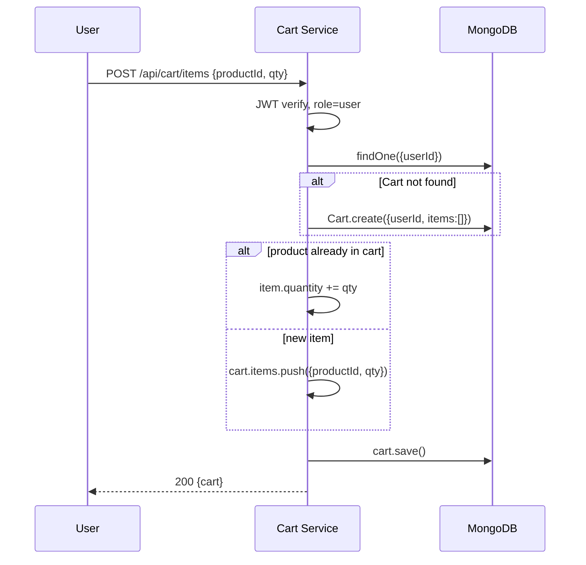

### API Endpoints

| Method     | Endpoint                       | Auth |   Role   | Description                       |
| :--------- | :----------------------------- | :--: | :------: | :-------------------------------- |
| `GET`    | `/api/cart`                  | Yes | `user` | Retrieve cart + totals            |
| `POST`   | `/api/cart/items`            | Yes | `user` | Add / increment item              |
| `PATCH`  | `/api/cart/items/:productId` | Yes | `user` | Set quantity (auto-prune if <= 0) |
| `DELETE` | `/api/cart/items/:productId` | Yes | `user` | Remove specific item              |
| `DELETE` | `/api/cart`                  | Yes | `user` | Clear entire cart                 |

---

## 4️⃣ Order Service (`Order/` — Port 3003)

Orchestrates order creation by fetching cart (HTTP), reserving inventory (HTTP), persisting the order, and publishing to RabbitMQ. Supports retrieval, cancellation, and address updates.

### UML Class Diagram

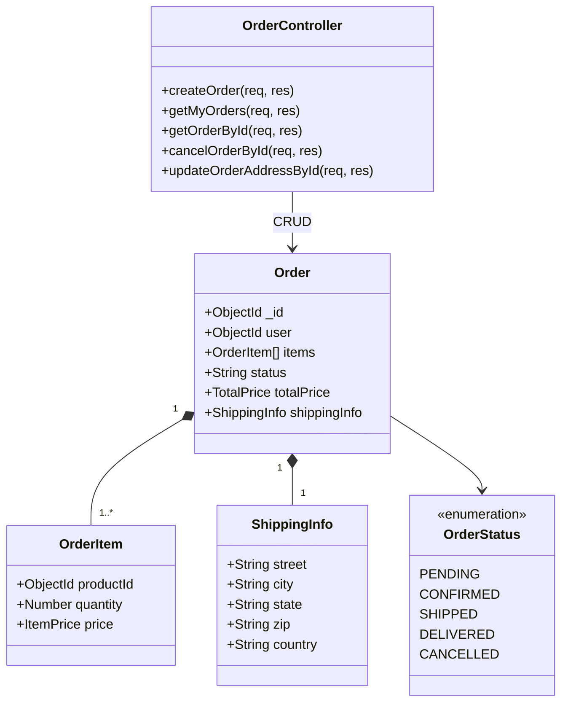

### Sequence Diagram — Create Order

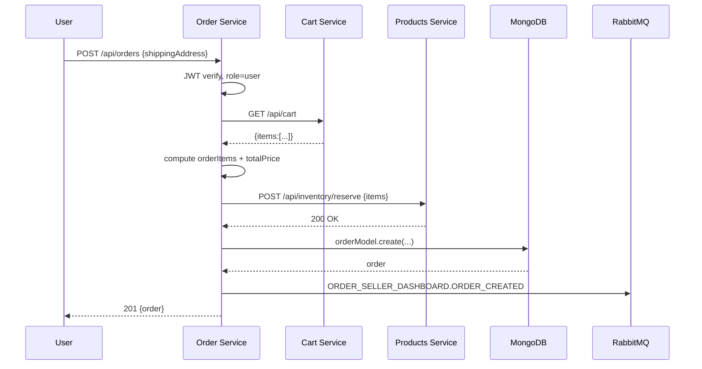

### API Endpoints

| Method    | Endpoint                    | Auth |        Role        | Description                    |
| :-------- | :-------------------------- | :--: | :-----------------: | :----------------------------- |
| `POST`  | `/api/orders`             | Yes |      `user`      | Create order from cart         |
| `GET`   | `/api/orders/me`          | Yes |      `user`      | List own orders (paginated)    |
| `GET`   | `/api/orders/:id`         | Yes | `user`, `admin` | Get order (ownership enforced) |
| `POST`  | `/api/orders/:id/cancel`  | Yes |      `user`      | Cancel order                   |
| `PATCH` | `/api/orders/:id/address` | Yes |      `user`      | Update address (PENDING only)  |

### Events Published

| Queue                                    | Trigger         | Consumers        |
| :--------------------------------------- | :-------------- | :--------------- |
| `ORDER_SELLER_DASHBOARD.ORDER_CREATED` | On order create | Seller-Dashboard |

---

## 5️⃣ Payment Service (`Payment/` — Port 3004)

Integrates with **Razorpay** to create payment orders and verify HMAC signatures. Publishes lifecycle events to Notification and Seller-Dashboard queues.

### UML Class Diagram

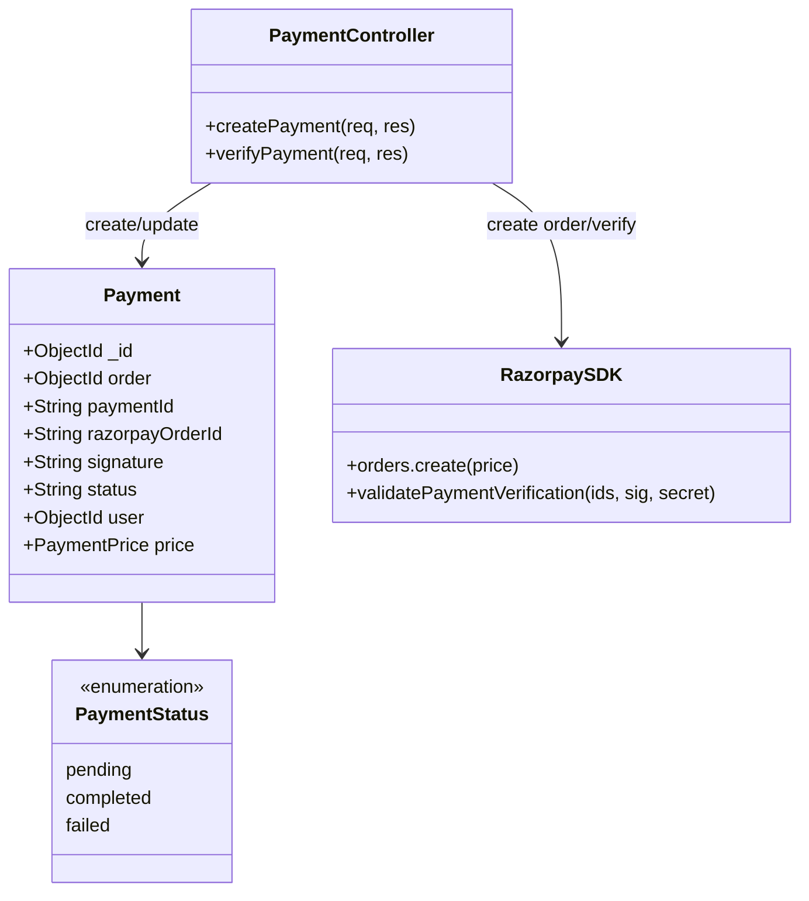

### Sequence Diagram — Payment Flow

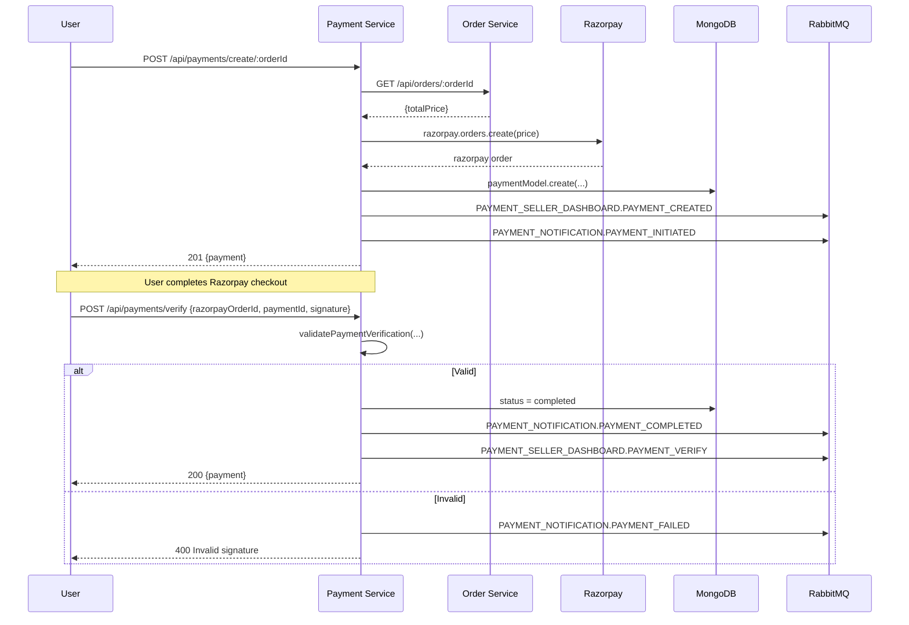

### API Endpoints

| Method   | Endpoint                          | Auth |   Role   | Description              |
| :------- | :-------------------------------- | :--: | :------: | :----------------------- |
| `POST` | `/api/payments/create/:orderId` | Yes | `user` | Create Razorpay order    |
| `POST` | `/api/payments/verify`          | Yes | `user` | Verify payment signature |

### Events Published

| Queue                                        | Trigger              | Consumers        |
| :------------------------------------------- | :------------------- | :--------------- |
| `PAYMENT_NOTIFICATION.PAYMENT_INITIATED`   | On payment create    | Notification     |
| `PAYMENT_NOTIFICATION.PAYMENT_COMPLETED`   | On successful verify | Notification     |
| `PAYMENT_NOTIFICATION.PAYMENT_FAILED`      | On verify error      | Notification     |
| `PAYMENT_SELLER_DASHBOARD.PAYMENT_CREATED` | On payment create    | Seller-Dashboard |
| `PAYMENT_SELLER_DASHBOARD.PAYMENT_VERIFY`  | On successful verify | Seller-Dashboard |

---

## 6️⃣ AI-Buddy Service (`AI-Buddy/` — Port 3005)

A real-time AI shopping assistant powered by **Gemini 2.0 Flash** via LangGraph. Accepts messages over **Socket.IO** WebSocket, runs an agentic tool-calling loop, and streams responses back.

### UML Class Diagram

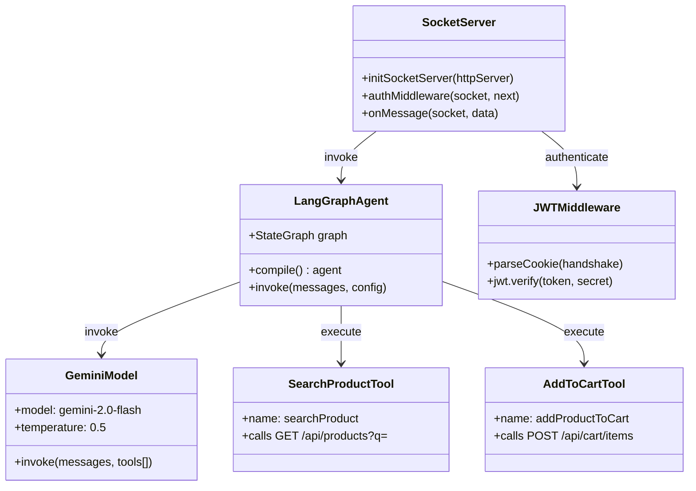

### Sequence Diagram — AI Chat

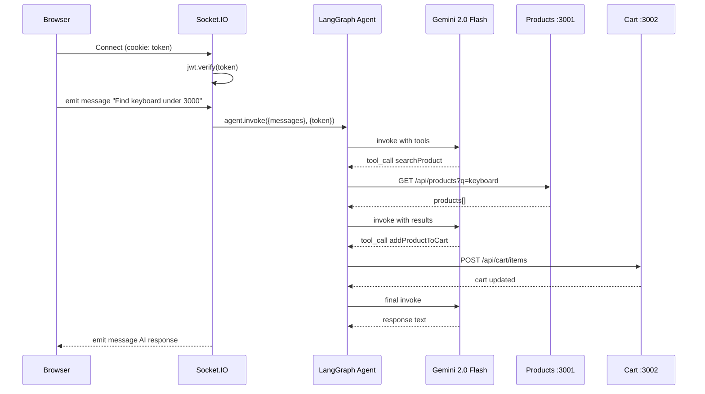

### Configuration

| Variable                                | Description                       |
| :-------------------------------------- | :-------------------------------- |
| `GOOGLE_API_KEY` / `GEMINI_API_KEY` | Google Gemini API key             |
| `JWT_SECRET` / `JWT_SECRET_KEY`     | Shared JWT secret for socket auth |

---

## 7️⃣ Notification Service (`Notification/` — Port 3006)

A pure **event-driven consumer** with no HTTP API. Subscribes to RabbitMQ queues and dispatches transactional HTML emails via **Nodemailer** with Gmail OAuth2.

### UML Class Diagram

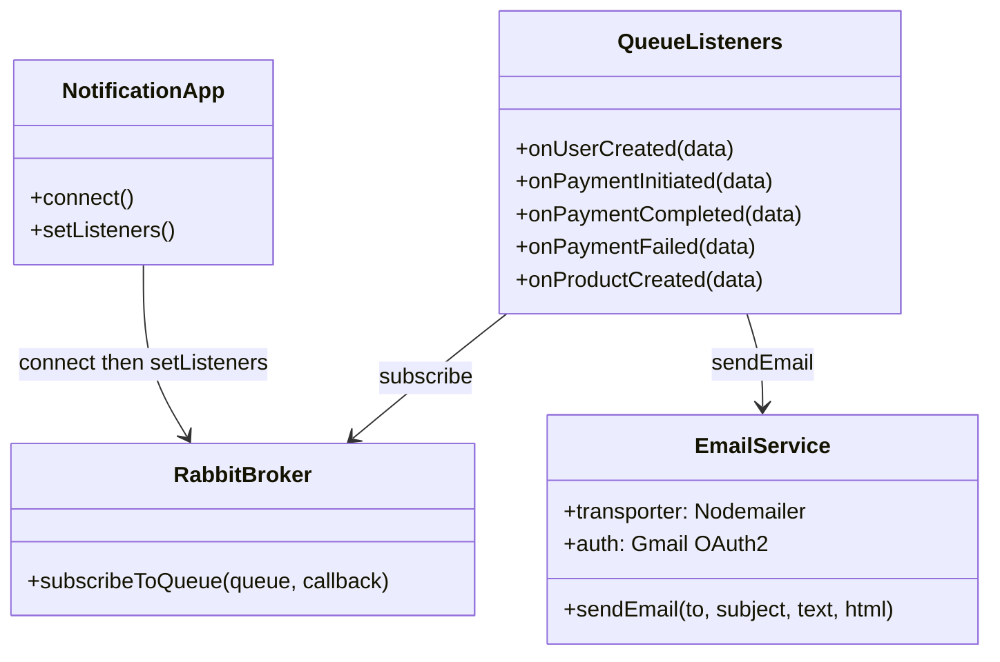

### Queue Subscriptions

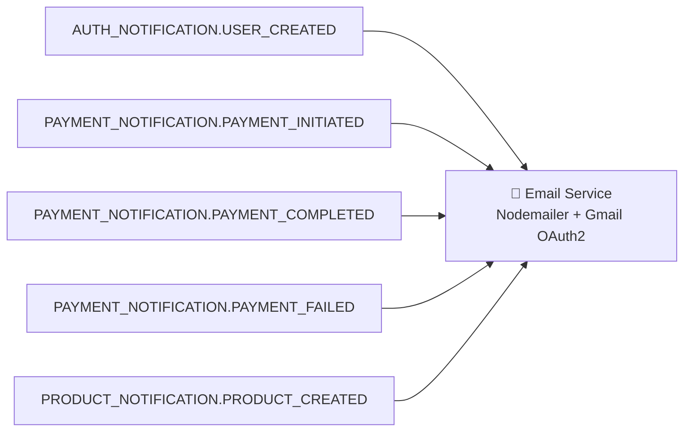

### Email Templates

| Event                   | Subject                  | Key Payload Fields                   |
| :---------------------- | :----------------------- | :----------------------------------- |
| `AUTH...USER_CREATED` | "Welcome to our Service" | username, fullName                   |
| `PAYMENT...INITIATED` | "Payment Initiated"      | orderId, paymentId, amount, currency |
| `PAYMENT...COMPLETED` | "Payment Completed"      | orderId, paymentId, amount, currency |
| `PAYMENT...FAILED`    | "Payment Failed"         | orderId, paymentId                   |
| `PRODUCT...CREATED`   | "Product Available"      | title                                |

### Environment Variables

| Variable          | Description                 |
| :---------------- | :-------------------------- |
| `RABBIT_URL`    | RabbitMQ connection URL     |
| `EMAIL_USER`    | Gmail account address       |
| `CLIENT_ID`     | Google OAuth2 Client ID     |
| `CLIENT_SECRET` | Google OAuth2 Client Secret |
| `REFRESH_TOKEN` | Gmail OAuth2 refresh token  |

---

## 8️⃣ Seller-Dashboard Service (`Seller-Dashboard/` — Port 3007)

A **read-model** service that maintains a local MongoDB replica of users, products, orders, and payments synchronized from RabbitMQ events. Exposes seller analytics via protected REST API.

### UML Class Diagram

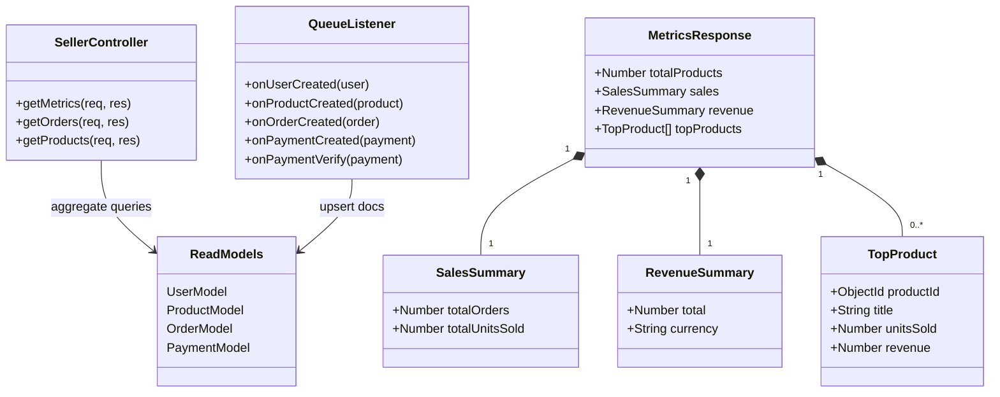

### Sequence Diagram — getMetrics

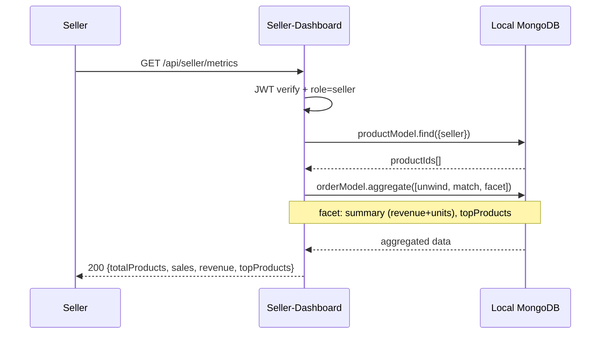

### API Endpoints

| Method  | Endpoint                 | Auth |    Role    | Description                          |
| :------ | :----------------------- | :--: | :--------: | :----------------------------------- |
| `GET` | `/api/seller/metrics`  | Yes | `seller` | Sales metrics, revenue, top products |
| `GET` | `/api/seller/orders`   | Yes | `seller` | Orders containing seller's products  |
| `GET` | `/api/seller/products` | Yes | `seller` | Seller's products (local replica)    |

### Queue Subscriptions & Actions

| Queue                                        | Action                                 |
| :------------------------------------------- | :------------------------------------- |
| `AUTH_SELLER_DASHBOARD.USER_CREATED`       | `userModel.create(user)`             |
| `PRODUCT_SELLER_DASHBOARD.PRODUCT_CREATED` | `productModel.create(product)`       |
| `ORDER_SELLER_DASHBOARD.ORDER_CREATED`     | `orderModel.create(order)`           |
| `PAYMENT_SELLER_DASHBOARD.PAYMENT_CREATED` | `paymentModel.create(payment)`       |
| `PAYMENT_SELLER_DASHBOARD.PAYMENT_VERIFY`  | `paymentModel.findOneAndUpdate(...)` |

---

## 🗄️ Database Schemas

### Auth — User & Address

```javascript
const addressSchema = new mongoose.Schema({
  street: String, city: String, state: String,
  pincode: String, phone: String,
  country: { type: String, default: 'India' },
  isDefault: { type: Boolean, default: false }
});
const userSchema = new mongoose.Schema({
  username: { type: String, unique: true, lowercase: true },
  email:    { type: String, unique: true, lowercase: true },
  password: { type: String, select: false },
  fullName: { firstName: String, lastName: String },
  role:     { type: String, enum: ['user', 'seller'], default: 'user' },
  address:  [addressSchema]
}, { timestamps: true });
```

### Products — Product

```javascript
const productSchema = new mongoose.Schema({
  title:       { type: String, required: true, trim: true },
  description: { type: String, default: '' },
  price:       { amount: { type: Number, required: true }, currency: { type: String, enum: ['INR','USD'], default: 'INR' } },
  seller:      { type: mongoose.Schema.Types.ObjectId, required: true },
  images:      [{ url: String, thumbnail: String, id: String }]
});
productSchema.index({ title: 'text', description: 'text' });
```

### Cart — Cart

```javascript
const cartSchema = new mongoose.Schema({
  userId: { type: mongoose.Schema.Types.ObjectId, required: true },
  items:  [{ productId: mongoose.Schema.Types.ObjectId, quantity: { type: Number, min: 1 } }]
}, { timestamps: true });
```

### Order — Order

```javascript
const orderSchema = new mongoose.Schema({
  user:        { type: mongoose.Schema.Types.ObjectId, required: true },
  items:       [{ productId: mongoose.Schema.Types.ObjectId, quantity: Number,
                  price: { amount: Number, currency: { type: String, enum: ['INR','USD'] } } }],
  status:      { type: String, enum: ['PENDING','CONFIRMED','SHIPPED','DELIVERED','CANCELLED'], default: 'PENDING' },
  totalPrice:  { amount: Number, currency: { type: String, enum: ['INR','USD'] } },
  shippingInfo:{ street: String, city: String, state: String, zip: String, country: String }
}, { timestamp: true });
```

### Payment — Payment

```javascript
const paymentSchema = new mongoose.Schema({
  order:           { type: mongoose.Schema.Types.ObjectId, required: true },
  paymentId:       String,
  razorpayOrderId: { type: String, required: true },
  signature:       String,
  status:          { type: String, enum: ['pending','completed','failed'], default: 'pending' },
  user:            { type: mongoose.Schema.Types.ObjectId, required: true },
  price:           { amount: { type: Number, required: true }, currency: { type: String, enum: ['INR','USD'], default: 'INR' } }
}, { timestamps: true });
```

---

## ⚙️ Getting Started

### Prerequisites

- [Node.js](https://nodejs.org/) >= v18
- [MongoDB](https://www.mongodb.com/) — Atlas or local
- [Redis](https://redis.io/) — Auth service only
- [RabbitMQ](https://www.rabbitmq.com/) — all event-driven services
- [ImageKit](https://imagekit.io/) — Products service
- [Razorpay](https://razorpay.com/) — Payment service
- [Google Cloud OAuth2](https://console.cloud.google.com/) — Notification service
- [Google Gemini API Key](https://ai.google.dev/) — AI-Buddy service

### Service Startup

```bash
git clone https://github.com/itsam-13/Vendora.git
cd Vendora
```

| Service          | Command                                | Port |
| :--------------- | :------------------------------------- | :--: |
| Auth             | `cd Auth && npm run dev`             | 3000 |
| Products         | `cd Products && npm run dev`         | 3001 |
| Cart             | `cd Cart && npm run dev`             | 3002 |
| Order            | `cd Order && npm run dev`            | 3003 |
| Payment          | `cd Payment && npm run dev`          | 3004 |
| AI-Buddy         | `cd AI-Buddy && npm run dev`         | 3005 |
| Notification     | `cd Notification && npm run dev`     | 3006 |
| Seller-Dashboard | `cd Seller-Dashboard && npm run dev` | 3007 |

### Environment Variables per Service

#### `Auth/.env`

```ini
PORT=3000
NODE_ENV=development
MONGO_URI=mongodb+srv://<user>:<pass>@cluster.mongodb.net/VendoraAuth
JWT_SECRET_KEY=your_shared_jwt_secret
REDIS_HOST=127.0.0.1
REDIS_PORT=6379
REDIS_PASSWORD=
RABBIT_URL=amqp://localhost
```

#### `Products/.env`

```ini
PORT=3001
NODE_ENV=development
MONGO_URI=mongodb+srv://<user>:<pass>@cluster.mongodb.net/VendoraProducts
JWT_SECRET_KEY=your_shared_jwt_secret
IMAGEKIT_PUBLIC_KEY=your_imagekit_public_key
IMAGEKIT_PRIVATE_KEY=your_imagekit_private_key
IMAGEKIT_URL_ENDPOINT=https://ik.imagekit.io/your_endpoint
RABBIT_URL=amqp://localhost
```

#### `Cart/.env`

```ini
PORT=3002
NODE_ENV=development
MONGO_URI=mongodb+srv://<user>:<pass>@cluster.mongodb.net/VendoraCart
JWT_SECRET_KEY=your_shared_jwt_secret
```

#### `Order/.env`

```ini
PORT=3003
NODE_ENV=development
MONGO_URI=mongodb+srv://<user>:<pass>@cluster.mongodb.net/VendoraOrder
JWT_SECRET_KEY=your_shared_jwt_secret
RABBIT_URL=amqp://localhost
CART_SERVICE_URL=http://localhost:3002
INVENTORY_SERVICE_URL=http://localhost:3001
```

#### `Payment/.env`

```ini
PORT=3004
NODE_ENV=development
MONGO_URI=mongodb+srv://<user>:<pass>@cluster.mongodb.net/VendoraPayment
JWT_SECRET_KEY=your_shared_jwt_secret
RABBIT_URL=amqp://localhost
RAZORPAY_KEY_ID=rzp_test_xxxxx
RAZORPAY_KEY_SECRET=your_razorpay_secret
```

#### `AI-Buddy/.env`

```ini
PORT=3005
GOOGLE_API_KEY=your_gemini_api_key
JWT_SECRET=your_shared_jwt_secret
```

#### `Notification/.env`

```ini
PORT=3006
RABBIT_URL=amqp://localhost
EMAIL_USER=your_gmail@gmail.com
CLIENT_ID=your_google_oauth_client_id
CLIENT_SECRET=your_google_oauth_client_secret
REFRESH_TOKEN=your_gmail_refresh_token
```

#### `Seller-Dashboard/.env`

```ini
PORT=3007
NODE_ENV=development
MONGO_URI=mongodb+srv://<user>:<pass>@cluster.mongodb.net/VendoraSellerDash
JWT_SECRET_KEY=your_shared_jwt_secret
RABBIT_URL=amqp://localhost
```

> **Important:** All services share the **same `JWT_SECRET_KEY`** so that tokens issued by Auth are accepted by every downstream service.

> **Note:** Each service uses its **own MongoDB database**. The Seller-Dashboard maintains read-model replicas synchronized via RabbitMQ — never via direct cross-service DB access.

---

## 🧪 Testing

| Service         |               Tests |       Suites |
| :-------------- | ------------------: | -----------: |
| Auth            |                  34 |            5 |
| Products        |                  50 |            1 |
| Cart            |                  29 |            1 |
| Order           | (integration tests) |            1 |
| **Total** |      **113+** | **8+** |

```bash
cd Auth && npm test      # 34 tests, 5 suites
cd Products && npm test  # 50 tests, 1 suite
cd Cart && npm test      # 29 tests, 1 suite
cd Order && npm test     # integration tests
```

---

## 🗺️ Roadmap

- [X] **Auth Service** — JWT, Redis blacklist, address book
- [X] **Products Service** — RBAC, ImageKit CDN, full-text search, pagination
- [X] **Cart Service** — Smart merging, auto-pruning, live totals
- [X] **Order Service** — Cart fetch, inventory reserve, lifecycle management
- [X] **Payment Service** — Razorpay integration, HMAC signature verification
- [X] **AI-Buddy Service** — Gemini 2.0 Flash agentic assistant, Socket.IO, tool-calling
- [X] **Notification Service** — Event-driven email with Gmail OAuth2
- [X] **Seller-Dashboard Service** — Read-model analytics, revenue metrics, top products
- [ ] **API Gateway** — Unified reverse proxy, central auth routing, rate limiting
- [ ] **Inventory Service** — Stock tracking and reservation management
- [ ] **Review & Rating Service** — Product reviews with seller reputation scoring
- [ ] **Docker Compose** — Full containerization for local development

---

## 📄 License

This project is licensed under the [ISC License](LICENSE).
